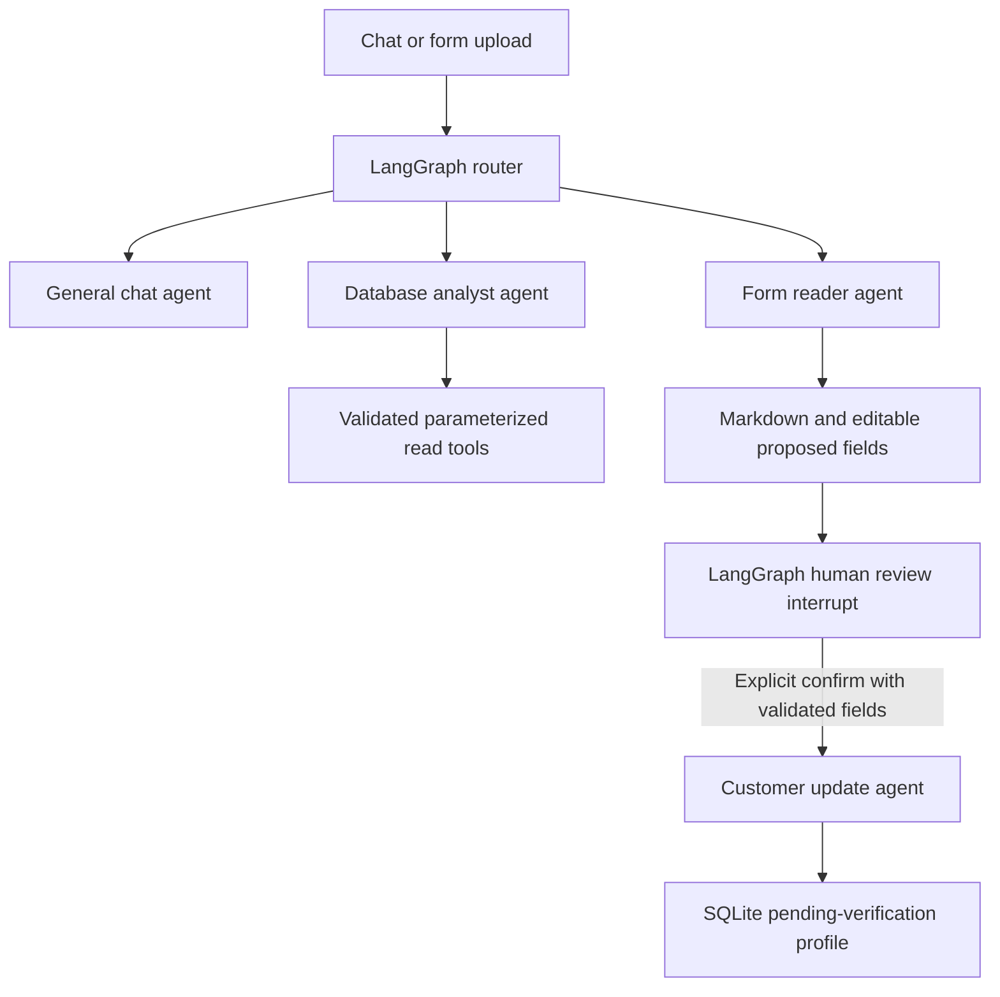

# BankWeave local agent backend

FastAPI + LangGraph + SQLite. Vertex AI / Gemini is intentionally disconnected until deployment. Routing and general chat are deterministic local implementations; this is not an LLM-powered conversation yet. Fraud answers are computed from SQL. Printed form OCR runs locally through RapidOCR (ONNX); PDF text is extracted with PyMuPDF.

## Setup (Windows PowerShell)

```powershell
npm install
python -m venv backend/.venv
backend/.venv/Scripts/python.exe -m pip install -r backend/requirements.txt
npm run backend:seed
npm run dev
```

On macOS/Linux use `backend/.venv/bin/python` for pip. Node 20.9+ and Python 3.11+ are required. The first seed downloads the five public BankShield sample CSVs at a pinned revision, approximately 1 MB, and caches them locally. It does not purchase or download the paid full dataset. After that, the demo works offline. `npm run dev` starts/reuses the loopback FastAPI service on port 8000 and runs Next.js on port 3000. `npm start` does the same for a previously built frontend. `RISKLENS_PYTHON` and `RISKLENS_BACKEND_URL` are optional server-side overrides.

## Agent workflow



The database agent receives a validated dataset/month/filter scope, not SQL generated from user text. Bounded evidence reads return original transaction IDs, amounts, geography and relationship coverage. Customer writes are a separate tool behind a checkpointed LangGraph interrupt. A chat message or instructions embedded in a form cannot invoke that write tool. Confirmation is idempotent for a single draft and its matching workflow. Checkpoints and SQL transactions persist locally across backend restarts.

## Try it

1. Ask **Why did fraud increase this month?** on Meridian. Follow up **Only Ahmedabad**, **Compare it to Surat**, then investigate, browse evidence, run a scenario and export a report.
2. Switch AI Analyst to **BankShield public sample**, choose a historical month, then ask **Show suspicious transactions** or **Show merchant categories**. The USD dataset is kept separate from the INR demo.
3. Download `/demo/customer-form.pdf` from the composer Tools menu, or use `public/demo/customer-form.png`. Both contain fictional demo details. Attach the scanned PDF/image using the paperclip. Markdown appears in chat; correct the proposed fields and click **Confirm & add customer**.
4. Inspect `http://127.0.0.1:8000/docs` or `GET /customers` to verify the saved customer profile. Saving is not KYC approval or account opening.

## APIs

The **Data Workspace** adds a manual customer directory with search, pagination, creation, editing and deletion. Profiles from reviewed forms appear in the same directory. Edits/deletions check the record revision to reject stale changes. Customers with linked accounts, loans or insurance cannot be deleted. Deleting an onboarding profile removes its directory/base customer rows, marks its source draft deleted, and prevents a saved graph confirmation from reporting it as active again; extracted form content and audit history are retained. Imported banking tables are browsable through an allowlist and remain read-only.

- `GET /data/customers`, `POST /data/customers`
- `PATCH /data/customers/{id}`, `DELETE /data/customers/{id}` (revision required)
- `GET /data/records` (dataset, table, literal search, bounded pagination)

- `GET /health`, `/datasets`, `/history`, `/customers`
- `GET /session` — restore the selected conversation and shared report references.
- `GET /conversations` — workspace-owned saved chat summaries, newest activity first.
- `POST /conversations` — new empty chat with a validated dataset/month; populated chats are preserved.
- `PATCH /conversations` — reopen an owned chat by ID, including rich results and current form-review status.
- `POST /analyst`, `/investigations`, `/evidence`, `/scenarios`, `/reports`
- `POST /forms` — multipart file, at most 8 MB; PDF at most 5 pages or PNG/JPEG.
- `GET /data/imports/schema`, `/data/imports/template`, `/data/imports/history` — typed formats, dataset-aware CSV examples and owned review receipts.
- `POST /data/imports/file` — bounded CSV/XLSX parsing; original bytes are discarded, parsed rows are staged.
- `POST /data/imports/review` — worksheet/entity/column mapping plus validation, without active record writes.
- `POST /data/imports/apply` — explicitly confirmed, revalidated atomic record append with replay-safe receipts.
- `POST /customers` — matching `threadId`, `draftId`, `confirmed: true`, and validated edited `fields`.

The browser uses same-origin Next.js proxy routes. Backend URLs and future credentials stay on the server. Reports reload the canonical investigation from SQLite; client-submitted analytical values cannot replace source results. Dashboard, Radar, fraud/loan analytics, versioned policy retrieval, cases, forms and reports use the backend. Fixture adapters remain for tests and unsupported scenario types.

## Data provenance and limits

Requests carry the existing `x-risklens-session` recovery handle plus `x-risklens-conversation` for their selected chat. The server checks staff/workspace ownership and pins streamed results to that chat, even if another tab switches the workspace default. The operation fingerprint includes the conversation ID, so replay cannot deliver a different chat's answer. Reports remain shared within the workspace. Migration `015_conversations` lazily upgrades the previous single saved thread without deleting its artifacts. These recovery handles are not authentication.

Meridian has coherent synthetic customer/account/transaction relations, six months and fixture-defined device patterns. BankShield is a separate public synthetic benchmark: 5,000 transactions, 42 positive fraud labels, 19 missing dates, 4,740 missing account parents, and only 10 complete transaction→account→customer chains. No transaction-level device identifier is available. No missing parents, device links, branches or loan data are invented. Country/merchant analysis is supported; BankShield device-ring and loan investigations are blocked. Publisher labels are synthetic ground truth, not dated bank adjudications. Amounts are integer minor units; exposure is transaction value under review, not loss. Source revision and hashes accompany analysis/report metadata.

Original uploaded bytes are deleted after processing; extracted Markdown, proposed fields, confirmed profiles and LangGraph checkpoints remain in local SQLite. Do not use real customer documents in this unauthenticated local demo. Clear printed English text is supported; handwriting and regional-language forms need manual correction or the future Gemini reader. Low-confidence extraction is never an approval decision. Session-scoped chat, active investigation, reports and corrected/saved form reviews restore from SQLite. The browser stores a recovery key and theme. Risk dismissals and case actions persist with actor-attributed audits.

## Before GCP deployment

See [the import guide](../IMPORT_GUIDE.md) for the reviewed customer/account/transaction/loan wizard. Migration `016_structured_imports` adds staged uploads, mapped reviews and record provenance. Parsed content and receipts persist locally; upload-byte disposal is not a deletion/retention policy. Move these records and ownership mappings with the managed store, and define staging expiry/deletion before using real bank exports. Uploaded SQL commands are never executed.

Activate and evaluate the opt-in Vertex adapter for routing, general chat, cited policy answers and form reading while retaining the validated tool boundaries and human review interrupt. Add staff authentication, role/tenant-based authorization, write approval policy, private database connectivity, secrets management, encryption, retention/deletion rules, redacted audit logs and model/tool evaluations. Verify the applicable Vertex retention/logging terms and configuration; do not equate no training or no retention with unrestricted database access. No zero-retention promise is asserted by this implementation. No LangSmith or external model tracing is enabled locally.

## Verification

```powershell
npm run typecheck
npm test
npm run test:backend
npm run test:e2e
npm run build
```

Backend tests use an isolated temporary database and checkpoint store. Browser tests exercise both datasets, evidence/report scope, general-agent routing and scanned-PDF extraction with reviewed customer creation.

# Model provider boundary

`providers.py` defines typed routing, general reply, cited policy answer and form extraction contracts. The default `RISKLENS_PROVIDER=local` uses deterministic routing, scripted conversation and local OCR. SQL aggregates, record validation, review interrupts and customer writes remain backend tools; providers have no database credentials or write tools.

The optional Vertex adapter uses the [Google Gen AI SDK](https://github.com/googleapis/python-genai) with JSON output schemas. It requires explicit `RISKLENS_PROVIDER=vertex`, `RISKLENS_ENABLE_VERTEX=true`, project, location and model settings. None are enabled by this repository. The optional SDK is pinned in `requirements-vertex.txt`; live model availability, output quality, credentials and data handling are G02/G09 checks.

Routing/general calls receive a sanitized question only. Policy answering would transmit the question and bounded retrieved policy sections. Form extraction would transmit the bounded original document in Vertex mode; the UI and response metadata disclose this. The database is accessed by validated backend tools, not by the model. No automatic provider fallback disguises a failed cloud call as a successful local call. Fake-transport tests validate contracts and failure handling, not live Gemini quality.

# Local staff permissions

Settings provides test identities: viewer (reads), analyst (reads, analysis and form extraction), customer operator (those permissions plus reviewed customer writes). FastAPI enforces the same rules for direct calls, with additional checks at write/agent tools. Session artifacts belong to the selected staff identity. Access audit rows record actor, role, method, resource path, status and timestamp without query/document bodies.

Development identity headers are deliberately a loopback demo facility, not authentication. `RISKLENS_ENV=production` rejects this adapter and fails closed until a verified identity adapter is installed in G05. Cloud identity verification, tenant provisioning and record grants remain unverified. Do not expose development mode publicly.

## Additional local workflows

- `POST /analyst/stream`, `/investigations/stream`, `/forms/stream`: bounded SSE progress/results with `x-risklens-request-id`. Completed inputs replay the saved result. Different inputs cannot reuse a key; interrupted/cancelled/failed requests need a fresh key. Cancellation is cooperative at operation boundaries and cannot interrupt an SDK/OCR call already executing.
- `DELETE /operations/{id}`: scoped cancellation. Stream operations never execute account/payment/customer controls. Reviewed customer confirmation is a separate idempotent workflow.
- `GET /reports/{id}/download`: immutable HTML from canonical artifacts; content hash, workspace authorization and download audit.
- `GET/POST /policies`: versioned Markdown/plain-text library, section chunks and immutable citations. Only staff with analysis permission can ingest versions. Provider citations are checked against retrieved chunks. Local retrieval is lexical; document text cannot select tools or execute writes.
- `POST /detectors/run`: explicit threshold rules and actual snapshot hashes, source counts and immutable events. Radar materializes a snapshot on first read and reuses it on unchanged inputs. No scheduled/live monitoring is running.
- `GET /data/quality`, `POST /data/imports/preview`, `/data/imports/confirm`: per-dataset relationship coverage and transaction CSV schema/currency/date/parent/duplicate validation. Preview does not change active records; operator confirmation revalidates under an atomic transaction. Repeated confirmation returns its original receipt. Other table imports are outside this implemented CSV contract. Parsed previews are retained in SQLite; source file bytes are not retained separately.

## Customer products and review

All Meridian product modules join the original customer IDs. BankShield does not receive invented products or missing relationships.

- `GET /repayments/{customer}`: dated principal-only synthetic installments/payments evaluated at month end, overdue age and recorded principal balance. Generation assumes 48 equal installments and excludes interest, fees and earlier payments.
- `GET /insurance/{customer}`: recorded synthetic cover, premium, dates, effective status, nominee completeness and expiry. Missing active cover does not prove a customer is uninsured elsewhere; claims are unavailable.
- `PATCH /preferences/{customer}`, `GET /recommendations/{customer}` (includes preferences), `PATCH /recommendations/{customer}/{id}`: revisioned declared needs/consent, explicit rules, immutable input hashes and staff-review history. No automatic enrollment/contact or demographic suitability inference.
- `GET /financial-health/{customer}`: explicitly generated inflows/opening balances, synthetic outgoing classifications and separate recorded principal obligations. Original fixture transactions lack verified debit/credit direction. No salary verification, health score or affordability decision is made; missing histories remain unavailable.
- `GET/POST /kyc/customer/{customer}`, `PATCH /kyc/{case}`: workspace-owned review cases, extraction source/provenance, identity/address reference requirements, revision checks and actor history. Form confirmation links a pending profile. Reviewed means verification pending; there is no KYC-approval tool. Legacy profiles can open a manual review.
- Canonical fraud investigations include bounded observed relationship maps with source IDs/references and explicit sampling/correlation limits. Saved artifacts freeze these maps and their evidence.
- `GET /maintenance/{customer}`, `POST /maintenance/{customer}/accounts`, `/policies`, `/payments`, `PATCH /maintenance/{customer}/policies/{id}`, `POST /maintenance/{customer}/reverse`: typed synthetic observations with operator authorization, explicit confirmation/reason, atomic receipts, input fingerprints and stable retry IDs. Policy edits check revisions; payments cannot exceed unpaid due principal. Reversal rejects changed/referenced records or later unreversed operations. Receipts/history are workspace-owned. No real account opening, insurance issuance or payment execution occurs.

Migration creates schema only. Explicit demo seeding uses idempotent inserts for generated product/review data and retains reviewed profile edits, but replaces original source fixture tables. Back up imported or manually maintained source records before reseeding. Ordinary startup never seeds automatically.
