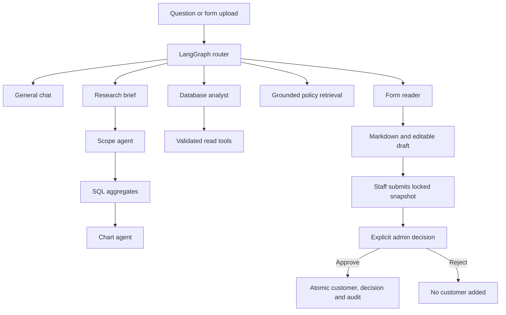

# Architecture and staff workflows

Setup commands are in [README](../README.md); cloud prerequisites are in [deployment](deployment.md).

## Request boundary

The browser calls same-origin Next.js routes under `app/api/`. These forward bounded requests to FastAPI; the browser cannot choose an upstream or supply database credentials/raw SQL. `services/contracts.ts` defines stable interfaces and `services/index.ts` composes the HTTP client. Mock calculations are reference fixtures under `tests/fixtures/` and are never imported by application routes.

Dashboard and Risk Radar gateways preserve the requested `datasetId` and historical `period`; calls without scope keep their original Meridian defaults. JSON, uploads, streams and downloads share the server-only transport in `services/fraud-backend.ts` and response/error decoding in `services/backend-response.ts`. HTTP authorization, validation, quota and availability statuses are preserved; malformed client stream bodies return 400, invalid successful upstream JSON returns 502, and internal/HTML upstream failure details are not returned to clients. Arrays are not treated as request records.

FastAPI owns database calculations, validation, artifact persistence, access checks and banking writes. SQLite stores application records; LangGraph has a separate SQLite checkpoint store. `backend/migrations/` is checksummed and append-only. Ordinary startup migrates but does not seed.

## Agents and rich responses

General greetings use general chat. A research question, or Research mode on a database question, uses three steps: a scope agent chooses the focus and series, SQL calculates only those aggregates, and a chart agent may select area, column, bar, or donut for an existing series. It cannot supply points. The answer can be downloaded as a PDF of the same blocks. Other database analyses use validated scope and parameterized SQL, returning reusable TEXT/KPI/CHART/TABLE/INSIGHT/EVIDENCE/ACTION/REPORT blocks. Chart values come from the same calculation as the figures. Policy answers cite versioned supplied sections and disclose unsupported coverage. The local provider uses scripted routing/chat and lexical policy retrieval; it is not a live LLM.

Local mode reads PDFs/images with PyMuPDF/RapidOCR; Vertex mode uses bounded Gemini extraction after the same file/page/pixel validation. Markdown renders in chat with copy/download/source view. The form workflow pauses before customer creation. Its customer node can reflect an already-recorded approval, not independently apply a write. Document instructions cannot select tools or approve banking actions. No external tracing is enabled.

The private VM's Vertex provider in `backend/providers.py` uses `gemini-3.5-flash-lite` at `global`. It supports typed routing with bounded analysis scope, concise general replies, grounded policy answers, document extraction and analytical narration. Follow-ups such as “Only Ahmedabad” and “Compare it to Surat” route to the database analyst. Local mode remains an explicit offline option.

For standard fraud/loan answers, the backend gives Gemini aggregate facts and existing chart series, excluding individual transaction/account/customer rows. Gemini composes a narrative using source placeholders; the backend substitutes exact verified statements and rejects unknown references or model-written numerical claims. Gemini may choose area/bar for an existing series, but cannot supply chart points, SQL or write tools. The original KPI/table/evidence blocks are preserved. Response metadata names the model/location and actually transmitted fields. These checks constrain numerical output; they do not establish model infallibility or authorize banking actions. See [Gemini chart design](deployment.md#gemini-and-chart-responses).

## Roles and approvals

| Role    | Permissions                                                           |
| ------- | --------------------------------------------------------------------- |
| Viewer  | Read records and available results                                    |
| Analyst | Read, analyse, investigate, extract/correct forms and submit requests |
| Admin   | Analyst capabilities plus banking writes and approval decisions       |

Only Admin can create/edit/delete customers, confirm imports, maintain account/policy/payment observations, change declarations or update KYC reviews. Analytical case notes, knowledge ingestion and recommendation discussion notes remain Analyst/Admin work. Viewer controls are disabled and APIs/agent entry points enforce permissions too.

The former `customer_operator` identifier is an Analyst compatibility alias. Original actor/session keys remain intact; it is not a fourth role. Settings switches local demo identities. Development identities are rejected in production. An opt-in IAP adapter now verifies signed assertions and explicit server-side staff grants; it is not configured or deployed. Public ingress, actual staff grants and authorized recovery of legacy workspaces remain G05 acceptance work. See [IAP configuration](deployment.md#verified-staff-identity--g05-preparation).

IAP mode accepts only ES256 tokens from the fixed Google public-key endpoint, the exact configured audience/issuer, valid bounded token times and a matching subject/email grant. Role and tenant are assigned by the private grants file; browser role headers and model claims cannot grant access. Current banking storage supports only `meridian-demo`, so grants for another tenant fail closed. Verified subjects receive separate stable actor IDs. Existing local actor attribution and workspace owners are preserved; no legacy workspace is implicitly granted to a new signed identity.

The Next gateway forwards the signed assertion in IAP mode and omits demo role headers. Identity discovery does not bind stale browser recovery handles. Browser recovery keys for verified staff are scoped to the server-assigned actor; development storage keys retain their original behavior. Public-key retrieval runs outside the API event loop, with a bounded timeout/cache, and staff grants are re-read so revocation takes effect without restart. No token, email, public-key response or claim payload is added to access logs.

OCR approval flow:

1. In AI Analyst, upload a clear printed PDF, PNG or JPEG. Review the Markdown and correct fields; inspect potential duplicate customers.
2. Choose **Submit for admin approval**. Submission saves a fixed, hashed snapshot and locks the fields; no customer is created.
3. As Admin, open **Data Workspace → Approval requests → Review request**. Inspect fields, Markdown, provenance and current duplicates.
4. Record a decision note and explicitly confirm. Approve adds/links a pending-verification profile; reject adds nothing. Duplicate linking never overwrites an existing profile.
5. Decision, customer write and audit events commit atomically. Replays reuse the result, conflicting/stale decisions are blocked, and approval history survives later profile deletion.
6. Staff can refresh approval status or reopen the saved chat. Rejected applications require a new corrected upload.

Admin can review the KYC case connected to a submitted form within the same tenant. This does not expose unrelated staff chats or another tenant. Neither customer creation nor marking a case reviewed verifies identity, opens an account or executes a transaction.

## Persistence and ownership

A staff-owned workspace contains separate conversations. Requests include a session recovery handle and selected conversation ID. Streams/replays remain pinned to their originating conversation even if another tab switches chats. Each tab retains its own selection. Reports are shared within the workspace and download immutable backend-generated HTML with a hash/access audit.

An uncertain stream HTTP failure (including 5xx, 408 and 429) retries the same operation ID, allowing the backend to replay its canonical completed result instead of creating another answer. Known terminal results use a new ID for a deliberate retry. If browser storage is blocked/full, the current page retains a stable in-memory recovery handle; server records remain intact, but automatic recovery after a page reload requires browser storage or an authorized recovery mapping. Local role switching reports a clear error when it cannot save the role.

Raw uploaded bytes are discarded after processing. Extracted text, corrected drafts, submitted snapshots, parsed import rows/reviews and receipts persist. File disposal is not a complete retention/deletion policy. Source and artifact versions are retained for historical evidence.

## API groups

| Area                    | Backend endpoints                                                                                            |
| ----------------------- | ------------------------------------------------------------------------------------------------------------ |
| Identity and history    | `/identity`, `/session`, `/conversations`, `/history`                                                        |
| Analysis                | `/datasets`, `/dashboard`, `/risk-radar`, `/analyst`, `/evidence`, `/investigations`, `/scenarios`           |
| Streaming               | `/analyst/stream`, `/forms/stream`, `/investigations/stream`, `/operations/{id}`                             |
| Forms and approvals     | `/forms`, `/forms/{id}`, `/customers` (submit), `/approvals`, `/approvals/{id}/decision`                     |
| Records/imports         | `/data/customers`, `/data/records`, `/data/quality`, `/data/imports/*`                                       |
| Products/reviews        | `/repayments`, `/insurance`, `/preferences`, `/recommendations`, `/financial-health`, `/kyc`, `/maintenance` |
| Knowledge/cases/exports | `/policies`, `/cases`, `/risk-state`, `/detectors/run`, `/reports`, `/reports/{id}/download`                 |

Supported record schemas and import limits are in [imports](imports.md). Dataset limitations are in [data sources](data-sources.md). Data currently supports historical synthetic analysis, not live banking decisions or compliance claims.

## Planned Card Campaigns replacement

The [Card Campaigns implementation plan](card-campaigns-plan.md) proposes replacing the Scenario Simulator page with a workflow that reuses Meridian customer IDs, adds versioned synthetic campaign inputs, applies explainable demo prospect/product rules, prepares outreach drafts, and delivers an immutable report to assigned staff in Command Center, Reports, and the notification inbox.

The proposed design keeps the existing application/checkpoint database separation, adds a durable campaign worker, and extends campaign-specific report permissions rather than sharing private chat recovery handles. Email-marketing consent is separate from the current declared-needs consent. Legacy scenario reports/chats remain readable. Customer email sending and card issuance are outside the first release. This is a planning reference only; existing runtime behavior is unchanged until implementation is instructed.
