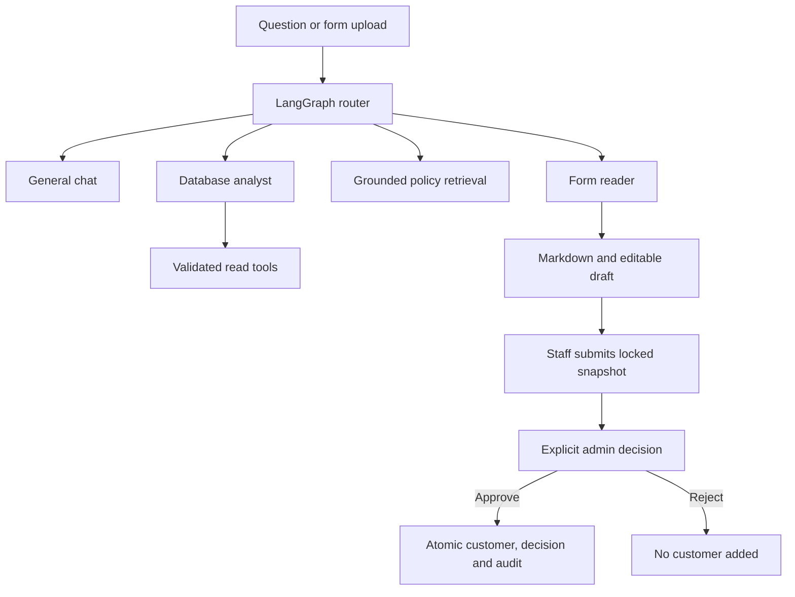

# Architecture and staff workflows

Setup commands are in [README](../README.md); cloud prerequisites are in [deployment](deployment.md).

## Request boundary

The browser calls same-origin Next.js routes under `app/api/`. These forward bounded requests to FastAPI; the browser cannot choose an upstream or supply database credentials/raw SQL. `services/contracts.ts` defines stable interfaces and `services/index.ts` composes the HTTP client. Mock calculations are reference fixtures under `tests/fixtures/` and are never imported by application routes.

FastAPI owns database calculations, validation, artifact persistence, access checks and banking writes. SQLite stores application records; LangGraph has a separate SQLite checkpoint store. `backend/migrations/` is checksummed and append-only. Ordinary startup migrates but does not seed.

## Agents and rich responses

General greetings use general chat. Database analyses use validated scope and parameterized SQL, returning reusable TEXT/KPI/CHART/TABLE/INSIGHT/EVIDENCE/ACTION/REPORT blocks. Chart values come from the same calculation as the figures. Policy answers cite versioned supplied sections and disclose unsupported coverage. The local provider uses scripted routing/chat and lexical policy retrieval; it is not a live LLM.

PDFs/images are read by PyMuPDF/RapidOCR locally. Markdown renders in chat with copy/download/source view. The form workflow pauses before customer creation. Its customer node can reflect an already-recorded approval, not independently apply a write. Document instructions cannot select tools or approve banking actions. No external tracing is enabled.

The optional Vertex provider in `backend/providers.py` currently defines typed routing, general replies, grounded policy replies and form extraction. Activation requires explicit environment settings; live model evaluation and analytical narration remain pending. See [Gemini chart design](deployment.md#gemini-and-chart-responses).

## Roles and approvals

| Role    | Permissions                                                           |
| ------- | --------------------------------------------------------------------- |
| Viewer  | Read records and available results                                    |
| Analyst | Read, analyse, investigate, extract/correct forms and submit requests |
| Admin   | Analyst capabilities plus banking writes and approval decisions       |

Only Admin can create/edit/delete customers, confirm imports, maintain account/policy/payment observations, change declarations or update KYC reviews. Analytical case notes, knowledge ingestion and recommendation discussion notes remain Analyst/Admin work. Viewer controls are disabled and APIs/agent entry points enforce permissions too.

The former `customer_operator` identifier is an Analyst compatibility alias. Original actor/session keys remain intact; it is not a fourth role. Settings switches local demo identities. Development identities are rejected in production; verified authentication/tenant grants remain a deployment requirement.

OCR approval flow:

1. In AI Analyst, upload a clear printed PDF, PNG or JPEG. Review the Markdown and correct fields; inspect potential duplicate customers.
2. Choose **Submit for admin approval**. Submission saves a fixed, hashed snapshot and locks the fields; no customer is created.
3. As Admin, open **Data Workspace → Approval requests → Review request**. Inspect fields, Markdown, provenance and current duplicates.
4. Record a decision note and explicitly confirm. Approve adds/links a pending-verification profile; reject adds nothing. Duplicate linking never overwrites an existing profile.
5. Decision, customer write and audit events commit atomically. Replays reuse the result, conflicting/stale decisions are blocked, and approval history survives later profile deletion.
6. Staff can refresh approval status or reopen the saved chat. Rejected applications require a new corrected upload.

Admin can review the KYC case connected to a submitted form within the same tenant. This does not expose unrelated staff chats or another tenant. Neither customer creation nor marking a case reviewed verifies identity, opens an account or executes a transaction.

## Persistence and ownership

A staff-owned workspace contains separate conversations. Requests include a session recovery handle and selected conversation ID. Streams/replays remain pinned to their originating conversation even if another tab switches chats. Each tab retains its own selection. Reports are shared within the workspace and download immutable backend-generated HTML with a hash/access audit.

Raw uploaded bytes are discarded after processing. Extracted text, corrected drafts, submitted snapshots, parsed import rows/reviews and receipts persist. File disposal is not a complete retention/deletion policy. Source and artifact versions are retained for historical evidence.

## API groups

| Area                    | Backend endpoints                                                                                            |
| ----------------------- | ------------------------------------------------------------------------------------------------------------ |
| Identity and history    | `/identity`, `/session`, `/conversations`, `/history`                                                        |
| Analysis                | `/datasets`, `/dashboard`, `/risk-radar`, `/analyst`, `/evidence`, `/investigations`, `/scenarios`           |
| Streaming               | `/analyst/stream`, `/forms/stream`, `/investigations/stream`, `/operations/{id}`                             |
| Forms and approvals     | `/forms`, `/forms/{id}`, `/customers` (submit), `/approvals`, `/approvals/{id}/decision`                     |
| Records/imports         | `/data/customers`, `/data/records`, `/data/quality`, `/data/imports/*`                                       |
| Products/reviews        | `/repayments`, `/insurance`, `/preferences`, `/recommendations`, `/financial-health`, `/kyc`, `/maintenance` |
| Knowledge/cases/exports | `/policies`, `/cases`, `/risk-state`, `/detectors/run`, `/reports`, `/reports/{id}/download`                 |

Supported record schemas and import limits are in [imports](imports.md). Dataset limitations are in [data sources](data-sources.md). Data currently supports historical synthetic analysis, not live banking decisions or compliance claims.
