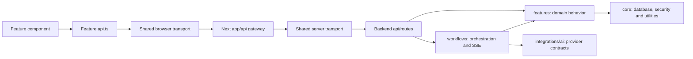
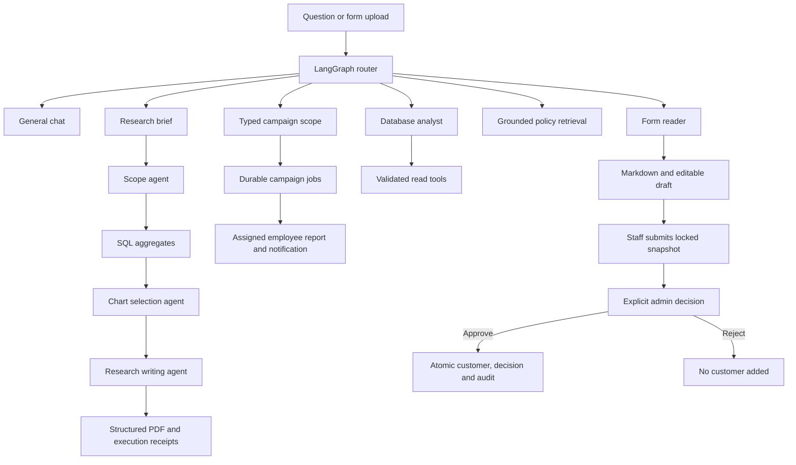
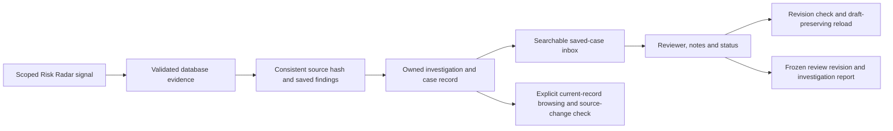
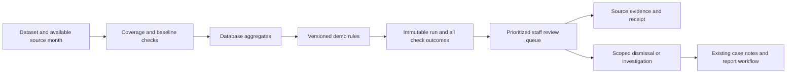

# Architecture and staff workflows

Setup commands are in [README](../README.md); cloud prerequisites are in [deployment](deployment.md).

## Request boundary

The browser calls same-origin Next.js routes under `frontend/src/app/api/`. A feature's `api.ts` uses `frontend/src/shared/api/client.ts` for identity, workspace recovery, JSON requests and conversation binding. Feature-owned `types.ts` or `types/` define the domain contracts; shared scope/response types live under `frontend/src/shared/types/`. Mock calculations and the static design reference belong exclusively to `frontend/tests/fixtures/`.

Dashboard and Risk Radar gateways preserve `datasetId` and historical `period`. Server-only JSON, upload, stream and download transport uses `frontend/src/shared/api/server.ts`; error decoding uses `errors.ts`. Gateways retain authorization/validation/quota/availability statuses. Malformed stream bodies return 400; invalid successful upstream JSON returns 502; internal/HTML failure details are not exposed. The browser cannot choose the upstream, submit raw SQL or obtain database credentials.

FastAPI owns calculations, validation, artifact persistence, access checks and banking writes. SQLite stores application records; LangGraph has a separate checkpoint store. `backend/migrations/` remains checksummed and append-only. Normal startup migrates without seeding.

## Source ownership and call flow

| Owner             | Place new work here                                                                                                                                                                                                                                           |
| ----------------- | ------------------------------------------------------------------------------------------------------------------------------------------------------------------------------------------------------------------------------------------------------------- |
| Frontend routes   | `frontend/src/app/`: Next route files, layout and style imports. The home route delegates to the Workspace feature.                                                                                                                                           |
| Frontend sections | `frontend/src/features/<section>/`: its components, hooks, `api.ts`, types and styles. Sections include workspace, dashboard, analyst, risk, investigations, campaigns, reports, knowledge, settings, customers, forms, imports and products.                 |
| Shared frontend   | `frontend/src/shared/ui/`, `analytics/`, `api/`, `types/`, `styles/`, `lib/`: reusable primitives and transport. Shared UI does not import feature screens.                                                                                                   |
| Backend HTTP      | `backend/api/`: composition/context/schemas and section routes. Routes delegate to the owning domain instead of duplicating business logic.                                                                                                                   |
| Backend sections  | `backend/features/<section>/`: service and section-specific records, rules, validation, queries and exports. Common analytical scoping and SQL live in `features/analytics/`; investigation snapshots and staff reviews belong to `features/investigations/`. |
| Agent workflows   | `backend/workflows/`: analyst graph, form processing and streamed operation replay/cancellation. Providers live in `backend/integrations/ai/`, split into contracts, call context, local and Vertex implementations.                                          |
| Infrastructure    | `backend/core/`: database paths/connections, identity, permissions, privacy, identifiers and progress. Core does not import HTTP routes or feature orchestration; features do not import HTTP routes.                                                         |
| Offline utilities | `backend/cli/`, `backend/evaluation/`, `scripts/runtime/`, `scripts/data/`, `scripts/checks/` and `scripts/systemd/`. Synthetic data generation stays under `demo/` and explicit data commands.                                                               |
| Tests             | `frontend/tests/{unit,e2e,fixtures}/` and `backend/tests/{unit,integration}/`. Fixtures cannot enter production imports. Generated output stays ignored.                                                                                                      |

Import the actual owner directly. Avoid repository-wide API/type barrels and compatibility wrappers for moved source files. The stable external boundaries are API URLs, `backend.app:app`, npm commands and persisted identifiers. Legacy scenario payloads/exports remain readable; the inactive simulator screen is removed. Knowledge, Reports and Settings have separate components/styles instead of a mixed resource file. Charts and generic analytical blocks share one renderer. Global CSS imports ordered feature/shared styles to retain the existing cascade.

`npm run check:structure` resolves local source imports and rejects old flat directories, production fixture imports and reversed infrastructure dependencies. Run it alongside typechecks, unit/integration tests, relevant browser workflows and the production build. After changing Python bindings, also run `uvx --from ruff==0.14.0 ruff check backend scripts --select I,F821,F811` (or install that Ruff version in a development environment). This catches undefined names inside deferred stream callbacks. `npm ci` installs both workspaces from the root lockfile. The production frontend artifact is `frontend/.next/standalone/frontend/server.js`; the launcher copies `frontend/public/` and `.next/static/` beside it.

Reorganization changes source ownership, not saved banking records. Existing database/checkpoint paths, checksummed migration files, recovery keys, actor aliases, `RISKLENS_*` configuration and `x-risklens-*` headers stay stable. Back up source plus matched application/checkpoint stores before deployment; never seed a working database to test the new layout.

## Agents and rich responses

General greetings use general chat. A research question, or Research mode on a database question, uses a scope agent, allowlisted SQL tools, a chart-selection agent and a separate writing agent. Scope includes the requested focus and relative month count, anchored to the selected available cutoff. SQL reconciles transactions, optional synthetic cashflows/principal payments and loan markers with consistent filters. The chart agent receives calculated aggregate series and may choose only supported series/kinds; it supplies no points. The writer receives qualitative patterns and source-reference descriptions with numerical values withheld. Source placeholders are expanded locally to exact SQL facts. Unsupported figures, missing chart references or an insufficient report depth produce a clearly labeled verified-data fallback. The saved report records actual call outcomes, token usage, elapsed time, validation status and database tools. Export PDF uses structured headings, Unicode fonts, axis-labeled vector charts, complete paginated tables, methodology/limitations and an execution appendix. The backend SHA-256 receipt is preserved by the Next gateway and checked before saving the binary PDF. Other database analyses use validated scope and parameterized SQL, returning reusable TEXT/KPI/CHART/TABLE/INSIGHT/EVIDENCE/ACTION/REPORT blocks. Chart values come from the same calculation as the figures. Policy answers cite versioned supplied sections and disclose unsupported coverage. The local provider uses scripted routing/chat and local ranked policy retrieval; it is not a live LLM.

The research PDF renderer preserves Markdown headings and list items, adds hanging indents, and splits dense saved prose at sentence boundaries into short reading blocks without rewriting words or values. A scope/indicator overview and linked contents precede the report; contents destinations and PDF bookmarks use the completed pagination. Normal paragraphs stay together, headings reserve space for their following paragraph, and oversized table cells continue across pages with repeated headers. Charts keep complete value tables. The writer prompt also requests short Markdown paragraphs, subheadings and review-task bullets, with source references as standalone factual statements. The export endpoint renders the saved response on demand; existing answers gain the improved layout when re-exported, with no new model call or saved-artifact update. Historical execution receipts remain historical receipts.

Local mode reads PDFs/images with PyMuPDF/RapidOCR; Vertex mode uses bounded Gemini extraction after the same file/page/pixel validation. Markdown renders in chat with copy/download/source view. The form workflow pauses before customer creation. Its customer node can reflect an already-recorded approval, not independently apply a write. Document instructions cannot select tools or approve banking actions. No external tracing is enabled.

The private VM's Vertex provider in `backend/integrations/ai/__init__.py` uses `gemini-3.5-flash-lite` at `global`. It supports typed routing with bounded analysis scope, concise general replies, grounded policy answers, document extraction and analytical narration. Follow-ups such as “Only Ahmedabad” and “Compare it to Surat” route to the database analyst. Local mode remains an explicit offline option.

For standard fraud/loan answers, the backend gives Gemini aggregate facts and existing chart series, excluding individual transaction/account/customer rows. Gemini composes a narrative using source placeholders; the backend substitutes exact verified statements and rejects unknown references or model-written numerical claims. Gemini may choose area/bar for an existing series, but cannot supply chart points, SQL or write tools. The original KPI/table/evidence blocks are preserved. Response metadata names the model/location and actually transmitted fields. These checks constrain numerical output; they do not establish model infallibility or authorize banking actions. See [Gemini chart design](deployment.md#gemini-and-chart-responses).

## Ranked policy search

The Knowledge Library and policy-answer agent share `backend/features/knowledge/search.py` through the Knowledge service. A read transaction selects the most recently ingested version of each document and its exact saved chunks. Unicode normalization, explicit banking vocabulary (for example, unusual payments → suspicious transactions and know your customer → KYC), and conservative unambiguous typo correction prepare terms for BM25 ranking with title/section boosts. At least 60% of meaningful query terms must match. This is a local vocabulary-based search for the small reference library; unfamiliar wording can still be missed. No embedding model, vector store or paid retrieval call is introduced.

`GET /policies/search?q=…` accepts up to 300 characters and returns up to eight sections with their exact text, immutable reference, source hash and policy version. It follows the existing shared policy-library read permission, including Viewer access. The Next gateway forwards identity to the same endpoint. Library requests debounce, abort on query changes and ignore outdated responses; search failures offer a retry without hiding page guides. Source dialogs show saved text rather than model paraphrases. Empty search restores the full document list.

The Analyst uses the same ranking with up to six sections, validates generated citation IDs against those sections and retains ordinary answer-provider receipts. A search coverage gap uses the local unsupported-answer response without a policy-answer model call; the separate Analyst routing step can still use its configured provider. Search neither updates source documents nor changes saved answers. New policy versions replace search candidates while old chunks and saved citations remain unchanged. Evaluation uses labeled synthetic questions against the previous lexical baseline; results do not establish real-bank relevance or regulatory correctness.

## Roles and approvals

| Role    | Permissions                                                           |
| ------- | --------------------------------------------------------------------- |
| Viewer  | Read records and available results                                    |
| Analyst | Read, analyse, investigate, extract/correct forms and submit requests |
| Admin   | Analyst capabilities plus banking writes and approval decisions       |

Only Admin can create/edit/delete customers; upload, preview/review and apply banking imports (`data_import`); publish shared policy versions (`policy_manage`); maintain account/policy/payment observations; change declarations; or update KYC reviews. Admin also decides form approvals and manages campaign review, catalog versions, consent, schedules and reviewed test email. Analytical case notes and recommendation discussion notes remain Analyst/Admin work. Viewer controls are disabled and APIs/domain tools enforce permissions too. Explicit demo seeding uses a narrowly scoped seed identity for bundled policy fixtures and restores the prior actor afterward; HTTP requests cannot invoke that seed path.

The former `customer_operator` identifier is an Analyst compatibility alias. Original actor/session keys remain intact; it is not a fourth role. Settings switches local demo identities. Development identities are rejected in production. An opt-in IAP adapter now verifies signed assertions and explicit server-side staff grants; it is not configured or deployed. Public ingress, actual staff grants and authorized recovery of legacy workspaces remain G05 acceptance work. See [IAP configuration](deployment.md#verified-staff-identity--g05-preparation).

IAP mode accepts only ES256 tokens from the fixed Google public-key endpoint, the exact configured audience/issuer, valid bounded token times and a matching subject/email grant. Role and tenant are assigned by the private grants file; browser role headers and model claims cannot grant access. Current banking storage supports only `meridian-demo`, so grants for another tenant fail closed. Verified subjects receive separate stable actor IDs. Existing local actor attribution and workspace owners are preserved; no legacy workspace is implicitly granted to a new signed identity.

The Next gateway forwards the signed assertion in IAP mode and omits demo role headers. Identity discovery does not bind stale browser recovery handles. Browser recovery keys for verified staff are scoped to the server-assigned actor; development storage keys retain their original behavior. Public-key retrieval runs outside the API event loop, with a bounded timeout/cache, and staff grants are re-read so revocation takes effect without restart. No token, email, public-key response or claim payload is added to access logs.

Role task assignment:

| Task                                                                              | Viewer       | Analyst / legacy employee | Admin |
| --------------------------------------------------------------------------------- | ------------ | ------------------------- | ----- |
| Browse dashboards, customer/source records and policy search                      | Read         | Read                      | Read  |
| Run analysis/research, detectors, investigations and case reviews                 | No           | Yes                       | Yes   |
| Extract/correct forms and submit customer requests                                | No           | Yes                       | Yes   |
| Review all employee requests and approve/reject customer creation                 | No           | Own request status only   | Yes   |
| Upload/paste CSV or Excel, preview mappings and confirm imports                   | No           | No                        | Yes   |
| Publish shared policy documents/versions                                          | No           | No                        | Yes   |
| Create/edit/delete customers, declarations, KYC and recorded maintenance/reversal | No           | No                        | Yes   |
| Prepare campaign reports and read assigned drafts                                 | Summary only | Yes                       | Yes   |
| Review campaign reports, catalog/consent/schedules and test email                 | No           | No                        | Yes   |

Admin sees **Upload new data** on Command Center and an **Admin tasks** panel in Data Workspace. Its shortcuts open customer approvals, imports, policy management and campaign administration. Non-admins keep browsing/own-request tracking but do not see these Admin shortcuts. Customer investigation buttons require analysis permission. These are role responsibilities using the existing demo identities, not a new staff-directory or person-assignment system.

OCR approval flow:

1. In AI Analyst, upload a clear printed PDF, PNG or JPEG. Review the Markdown and correct fields; inspect potential duplicate customers.
2. Choose **Submit for admin approval**. Submission saves a fixed, hashed snapshot and locks the fields; no customer is created.
3. As Admin, open **Data Workspace → Approval requests → Review request**. Inspect fields, Markdown, provenance and current duplicates.
4. Record a decision note and explicitly confirm. Approve adds/links a pending-verification profile; reject adds nothing. Duplicate linking never overwrites an existing profile.
5. Decision, customer write and audit events commit atomically. Replays reuse the result, conflicting/stale decisions are blocked, and approval history survives later profile deletion.
6. Staff can refresh approval status or reopen the saved chat. Rejected applications require a new corrected upload.

If a submission response is lost, the browser reads `GET /forms/{id}` through `GET /api/forms?id=…` to recover its canonical fields, revision and existing approval. This endpoint requires form-read permission and the owning actor/session artifact; it makes no model call or customer write. An unavailable recovery check leaves inputs and resubmission locked with **Check saved request status**. A confirmed pending draft allows an explicit retry; a committed request restores its approval without another submission. Autosave ignores late responses after submission, and Admin decision replays return the original customer.

Admin can review the KYC case connected to a submitted form within the same tenant. This does not expose unrelated staff chats or another tenant. Neither customer creation nor marking a case reviewed verifies identity, opens an account or executes a transaction.

## Persistence and ownership

A staff-owned workspace contains separate conversations. Requests include a session recovery handle and selected conversation ID. Streams/replays remain pinned to their originating conversation even if another tab switches chats. Each tab retains its own selection. Reports are shared within the workspace and download immutable backend-generated HTML with a hash/access audit.

An uncertain stream HTTP failure (including 5xx, 408 and 429) retries the same operation ID, allowing the backend to replay its canonical completed result instead of creating another answer. Known terminal results use a new ID for a deliberate retry. If browser storage is blocked/full, the current page retains a stable in-memory recovery handle; server records remain intact, but automatic recovery after a page reload requires browser storage or an authorized recovery mapping. Local role switching reports a clear error when it cannot save the role.

Raw uploaded bytes are discarded after processing. Extracted text, corrected drafts, submitted snapshots, parsed import rows/reviews and receipts persist. File disposal is not a complete retention/deletion policy. Source and artifact versions are retained for historical evidence.

## API groups

| Area                           | Backend endpoints                                                                                            |
| ------------------------------ | ------------------------------------------------------------------------------------------------------------ |
| Identity and history           | `/identity`, `/session`, `/conversations`, `/history`                                                        |
| Analysis                       | `/datasets`, `/dashboard`, `/risk-radar`, `/analyst`, `/evidence`, `/investigations`, `/scenarios`           |
| Campaigns and employee reports | `/card-campaigns/*`, `/campaign-reports/*`, `/staff-notifications/*`                                         |
| Streaming                      | `/analyst/stream`, `/forms/stream`, `/investigations/stream`, `/operations/{id}`                             |
| Forms and approvals            | `/forms`, `/forms/{id}`, `/customers` (submit), `/approvals`, `/approvals/{id}/decision`                     |
| Records/imports                | `/data/customers`, `/data/records`, `/data/quality`, `/data/imports/*`                                       |
| Products/reviews               | `/repayments`, `/insurance`, `/preferences`, `/recommendations`, `/financial-health`, `/kyc`, `/maintenance` |
| Knowledge/cases/exports        | `/policies`, `/cases`, `/risk-state`, `/detectors/run`, `/reports`, `/reports/{id}/download`                 |

Supported record schemas and import limits are in [imports](imports.md). Dataset limitations are in [data sources](data-sources.md). Data currently supports historical synthetic analysis, not live banking decisions or compliance claims.

## Investigation inbox, evidence and review

The 14 October review found existing database investigations, observed relationship maps and revisioned case notes, but no saved-case inbox, resolution-note requirement, conflict recovery or exported staff-review snapshot. The owner authorized improving the whole workflow. The implementation retains the original cases, source IDs, workspace ownership and report bytes.

- `/cases` lists only investigations linked to the requesting owned workspace, with bounded pagination, literal text search, dataset/status filters, latest review timestamps and owned report counts. A missing workspace exposes no saved-case list. `/cases/{id}/source` requires an owned workspace and checks the current source hash without creating or overwriting an investigation. Existing case IDs and role aliases remain intact. The Next gateway allowlists query fields and validates update payloads before forwarding to FastAPI.
- New investigations calculate metrics, bounded relationship evidence and their input hash while a SQLite write reservation prevents concurrent source changes. The reservation ends before artifact persistence. Existing detector source hashing is reused and extended with recorded device events, without creating a detection run. The saved JSON contains source counts/hash, capture time and a truthful database-evidence/zero-model-call receipt. Older investigations have no retroactively invented hash; source verification reports unavailable. Full-dataset hash changes may include observations outside the case filters and are described as dataset changes.
- Reopening an owned case updates the selected conversation's investigation pointer as well as applicable workspace state, so reload returns to the selected case. Sidebar navigation opens the inbox; direct case reopening and reload retain the case detail. The inbox works independently of Dashboard loading. Refreshing the same scope creates a separate investigation and keeps original notes/reports.
- The inbox explains the signal → evidence → staff decision → report workflow. The detail view separates Overview, Evidence & links, Review and Activity. Keyboard-operable tabs preserve the selected section for the case. The review form stays mounted but hidden outside Review, preserving drafts without crowding the evidence view or placing review controls above evidence on phones. Summary findings and charts stay in Overview; calculation receipts and analysis stages use expandable details. Current record pages are labeled separately from the saved evidence, with a manual source-change check and original snapshot receipt. Graph links remain bounded observed records, not inferred collusion. New-device investigation titles identify the actual flagged Ahmedabad scope.
- Unsaved form changes disable export/refresh and recover within the same browser session using a workspace/case-scoped draft key. These are explicitly unsaved device drafts, not server review events. Save/discard clears the draft. An outdated case revision returns 409; reloading current case state keeps the typed note. No-op updates cannot increment the revision. A transition to Resolved requires a non-empty resolution note. API permissions remain enforced; Viewer updates are denied. Development reviewer aliases remain selectable, while verified-mode reassignment waits for an actual staff directory rather than assigning a local demo identity.
- New reports copy the current case status, reviewer, revision, event history and capture time along with the frozen investigation. HTML exports include those review notes, monthly/segment tables and source receipt; all staff-supplied strings are escaped. Existing cached report HTML is immutable. Subsequent case edits or source changes cannot rewrite an earlier report. Displayed case/event times use Asia/Kolkata; stored source timestamps remain UTC.

Later work can add verified staff assignment, due dates and reason-coded dispositions through new reviewed schema changes, richer evidence annotations, and a separately authorized grounded AI case brief. This release does not infer confirmed fraud, train a detection model, authorize transactions or issue lending decisions.

### Case Review Assistant

Review → Prepare review brief sends only saved aggregate observations, saved coverage limitations and bounded review options to the existing typed Vertex provider. Gemini returns IDs selecting relevant observations, possible explanations and human checks. The backend validates the allowlists, uniqueness, required source-coverage check and BankShield incomplete-link hypothesis, then renders exact saved factual text. It supplies no model-authored figures or unvalidated factual narrative. Hypotheses and suggestions remain explicitly untested/unperformed. The draft note is assembled locally from selected references and checks; Use draft fills the existing editable note without changing status or overwriting an existing note. Saving remains the explicit revision-checked case update. Ordinary investigation construction still uses zero model calls.

`GET /cases/{id}/brief` reads saved preparation state. `POST /cases/{id}/brief` accepts only an optional strict boolean `retry`; there is no arbitrary question, prompt or client-authored evidence input. The Next `/api/cases/brief` gateway preserves errors and allows 85 seconds for the bounded 60-second provider call. Owned workspace/case access is required before reads, cache reuse or model calls; preparation also requires analyze permission. Raw evidence rows, customer identifiers, relationship nodes and staff review notes are excluded from the model projection. The brief UI links to its frozen source excerpts, separately from current-record browsing.

Additive migration `021_case_review_briefs` stores preparation keyed by case ID, canonical saved-artifact hash and prompt version, with tenant/creator, original source hash, actual model/call/token receipts and immutable completed content. A ready brief is reused even if live source rows or staff notes later change. Legacy cases without a source hash use their saved-artifact digest. A model configuration change does not silently replace an existing completed brief; the original model remains in its receipt.

Preparation uses a short SQLite claim transaction, then calls the provider without holding a write lock. At most two live preparation leases are allowed. Duplicate requests return the same pending/completed result. Failed or expired attempts require an explicit retry, capped at three attempts per saved snapshot/prompt. GET/polling never invokes a model. A 90-second lease and attempt token prevent an expired response from publishing over a replacement attempt. Provider failure or rejected selections leave the existing case usable and do not mutate its artifact, review, customer records or reports. Brief retention follows application storage; managed retention and staff identity remain separate production work.

## Risk Radar: detection and review

The 14 October review found an existing historical rule engine, not a trained detection model or live feed. Its manual frontend action always selected Meridian, its page label always said September 2026, and full-history comparisons could compare the same population against itself. The owner requested implementation after review. The first release keeps detection local and explainable, fixes scope and baseline handling, and makes the actual method visible.

### Current version

- `backend/features/risk/detection.py` publishes `snapshot-rules-v3`. Meridian checks flagged transaction growth, synthetic loan default-marker growth, flagged new-device activity in the existing Ahmedabad scope, and dated overdue principal (`RSK-004`). BankShield supports supplied transaction labels only. The new-device rule is explicitly named for its scope; it does not establish a device-sharing fraud cluster. Synthetic labels/default markers remain distinct from confirmed fraud and observed loan delinquency.
- Growth rules require the count threshold, relative count increase, a sufficient preceding-month positive count, and a rate increase of at least 0.25 percentage points. This guards against a count increase caused entirely by higher source volume. These are demonstration thresholds; rule priority is not a calibrated probability.
- Missing preceding-month observations, empty scopes and weak positive baselines produce an `insufficient` check. Non-matches, matches and insufficient-data checks are recorded together. A historical analytical `all` scope resolves to the latest available source month for detection; detection never compares full history with itself. Risk Radar offers concrete source months and always labels its baseline.
- Checks are stored in the existing run's JSON receipt, preserving old rows and the migration sequence. Unchanged inputs and rule version reuse the existing run. Old v1/v2 runs remain readable. Source hashes, rule versions, source counts, exact observed values and timestamps identify the execution. Detection invokes no model API.
- `/detectors/latest` reads the saved scoped run and reports absent/stale snapshots without creating a detector run. The Next gateway forwards dataset and period. The legacy Dashboard/radar paths still resolve historical snapshots through their existing lazy-recording behavior; this does not constitute scheduled monitoring. Moving all snapshot creation into an explicit job is future work.
- The Radar component owns its dataset/month view independently of Analyst chat scope. It fences outdated responses. Its run action, disposition reads/writes and investigation handoff use the same selected scope. Dismissals retain the current workspace and dataset/month ownership. Dashboard state refreshes after review, and evidence-to-investigation navigation retains the recorded scope.
- UI: dataset/month controls; visible “Recorded rules / 0 model calls”; open/high/dismissed summaries; searchable severity/category/dismissal filters; highest-severity signals first; source evidence; observed baseline/current counts and rates; threshold explanations; coverage and run receipts. No-run, no-match, missing-baseline, stale-source, loading and failure states are distinct. Stale runs cannot start a new investigation until refreshed. Viewer access remains read-only.

### Dated overdue principal — 17 October 2026

`backend/features/risk/overdue.py` calculates `RSK-004` from existing `loan_installments` and linked `loan_payments`, without reading the monthly default-marker field as a target. For each month-end cutoff it sums nonnegative integer principal payments received by that date, caps payment allocation at its original installment and computes unpaid principal and days past due. Later payments cannot clear an older cutoff. Qualifying installments are at least 14 days past due; their unpaid principal must sum to at least INR 1,000 within one loan. Count is distinct loans and exposure is qualifying overdue principal, rather than original loan value. These are published demo review criteria, not a regulatory default definition, verified balance, predicted loss or fraud probability. No preceding-month baseline is required.

The calculator quarantines a loan with invalid relevant dates/amounts. Loans with no usable due observations and unlinked records are reported explicitly. Unlinked records are counted dataset-wide because they cannot be reliably attributed to a region. A known signal can coexist with incomplete coverage; absent matches plus missing/invalid coverage yields `insufficient`, rather than a false clear. Priority is oldest qualifying overdue age, then unpaid principal, then loan ID. Existing growth rules and old receipts retain their meaning. BankShield has no linked repayment schedules and cannot select this rule.

An investigation freezes its cutoff, the first 20 qualifying loans in priority order, installment IDs, due/paid/unpaid amounts and the payment IDs/dates used. Current evidence paging separately shows all qualifying loans in the same scope. Shared source snapshot hashing already includes repayment tables, so corrections mark the case changed without rewriting its saved evidence. Reports freeze those references and the staff review revision; previously saved HTML files remain unchanged.

Related local policy search (`credit risk monitoring`) freezes exact section text, document/version/reference and checksum in the new case. These excerpts do not establish the demo thresholds or authorize collections. Missing applicable procedure is a review gap. Banking source checks do not detect subsequent policy-library revisions; frozen versions remain visible. Optional Case Review Assistant preparation receives saved aggregates and policy excerpts, plus bounded payment-cutoff and policy-check options, through the existing validated selection contract. Creating the signal, investigation and report makes zero model calls; optional brief preparation retains its existing separate provider receipt. No customer action, new database, processor, training pipeline or automatic email is introduced.

### Next detection work, in order

1. **Broader rules and dated data.** Replace the single-region device rule with per-region candidates, minimum-support checks and deduplication. Add actual device reuse/transaction velocity only where transaction/device links and timestamps support it. Dated overdue-principal detection is implemented below; further rules must retain the distinction between fixture default markers and dated observations. Missing evidence means unavailable detection, not zero risk. BankShield's missing joins must keep customer/device/loan rules unavailable.
2. **Durable detection jobs and alert lifecycle.** Add new migrations after the current applied sequence for durable jobs, signal identities, source references and review events. Identity should include tenant/dataset, rule, subject and time window; a replay must not duplicate alerts. Persist owner, status, review reason and exact run revision, link into existing cases/reports, and preserve workspace ownership of saved chats. Reuse durable-job patterns from Campaigns, with a separate detection job/service permission. Scheduling is explicit, with freshness and failures visible. “Live” is allowed only after a real ingestion feed and lag checks exist.
3. **Statistical anomaly evaluation.** Begin with robust per-account/peer baselines using only observations available before each cutoff. An optional Isolation Forest experiment can rank unusual feature combinations; outlier scores are not fraud probabilities. [Official anomaly-detection reference](https://scikit-learn.org/stable/modules/outlier_detection.html). Benchmark rules versus the anomaly candidate on held-out future observations before enabling it in the staff queue.
4. **Supervised model only after valid outcomes.** Require independently reviewed, dated labels with adequate positives; exclude `flagged`, source risk scores and downstream outcomes from features when they encode the target. Keep entity/time separation, fit transformations only on training data, and compare precision/recall, precision at the review-capacity limit, false alerts per period and segment performance. Use chronologically separated evaluation; [official time-series evaluation reference](https://scikit-learn.org/stable/modules/generated/sklearn.model_selection.TimeSeriesSplit.html). Six synthetic months and incomplete public-sample joins cannot establish deployment accuracy. Review dismissal is not automatically a confirmed negative label.
5. **Optional AI explanation.** Gemini 3.5 Flash Lite is already available to Analyst, but is not the detection engine. A separately authorized bounded aggregate context may support explanations after a saved detection result. Require source references, validated model output and actual call receipts, and disclose fallback. Models cannot invent alerts, values, customers, SQL or banking actions.

Phase-one acceptance covers scoped BankShield/Meridian execution and dismissal, missing baselines, traffic-only growth, stale hashes, read-only receipt retrieval, zero model calls, unchanged-input replay, evidence scope, permissions, browser reload and desktop/320px light/dark layout. Backend and browser tests run on temporary/copied stores. Deployment retains old detector snapshots, original banking IDs and saved reports/chats; no source reseeding or migration edits are allowed.

## Card Campaigns and employee reports

Card Campaigns replaces the visible Scenario Simulator page. The [design reference](card-campaigns-plan.md) explains its data boundaries. Migrations 018–020 add fourteen campaign tables to the existing application database; checkpoints remain separate. The explicit `scripts/data/generate-campaign-data.py` command freezes 5,000 existing Meridian identities, reuses April–September observations, and generates October–March campaign-only observations plus dated demo credit, holdings, collateral, and email consent. Original banking source tables are not reseeded. Data Workspace shows campaign readiness; BankShield and uncovered months fail with an explanation.

A durable worker leases accepted jobs, checkpoints features/rules/drafts, and atomically publishes a canonical hashed HTML report plus one notification per recipient. Source and product hashes, campaign revision, cutoff, currency, reason codes, counts, provider/model, transmitted fields and model usage remain attached to the report. Numerical and product-fit decisions use database tools/versioned rules. Names and approved fees enter drafts locally. Each run uses at most three product-template calls plus an optional maximum of twenty anonymous sample rewrites; failures use a labeled deterministic fallback.

`/card-campaigns`, `/campaign-reports`, and `/staff-notifications` are actor/tenant/assignment scoped and do not bind private chat recovery headers. Viewer reads assigned summaries; Analyst prepares runs and reads authorized candidate/draft detail; Admin maintains immutable catalog versions, reviews exact report revisions, records email-consent events and enables schedules. The internal worker principal has only campaign-run permission and cannot be selected as a browser role. Development runs include the requesting identity and local Admin; real named staff assignments require configured verified identities.

Command Center, Reports and the inbox open the same frozen employee report. The campaign page has paginated prospects/drafts, progress, cancellation, run history and Admin review/catalog/schedule controls. A typed Analyst campaign node returns a durable run link; only explicit prepare/run language creates work. Optional monthly schedules use the last completed month and wait for missing source coverage. Normal startup and the worker do not generate new synthetic months. Email consent is separate from declared-needs consent and is rechecked before publication and when opening drafts.

Legacy scenario URLs redirect to Card Campaigns; old report/comparison blocks remain readable and legacy simulate buttons are retired. The bounded `/scenarios` compatibility API remains. Original campaign reports retain their frozen zero-customer-email count. Later test deliveries are recorded separately as described below. Bulk customer outreach, card issuance and credit approval remain unavailable.

### Reviewed campaign test email

Migration `022_campaign_email_deliveries` adds durable test-submission receipts without changing original reports, drafts or banking records. Admin opens a completed report, records a revision-bound review, then opens Email drafts → Read email draft → Send test email. The destination is set privately on the backend; requests cannot supply an address, sender, subject or message body. Tests use a synthetic customer's existing personalized draft, clearly labeled as a fictional campaign sample. A saved Vertex draft remains a saved Vertex draft; sending makes no new model call.

`POST /campaign-reports/{id}/test-email` requires campaign-review permission, assigned tenant/report access, reviewed status and matching report hash/review revision. It verifies the saved draft hash and current contact permission. `GET /campaign-reports/{id}/email-deliveries` requires the same Admin permission and returns the configured test destination, remaining allowance and bounded receipt history. The Next gateway allowlists both operations and gives submission up to 85 seconds. SMTP credentials and server reply text never enter browser responses or ordinary logs.

The backend commits a unique claim for report/customer/recipient/draft hash before SMTP I/O. Concurrent or replayed requests reuse it; network calls happen outside SQLite write transactions. SMTP uses authenticated STARTTLS with certificate verification. Acceptance means the SMTP server accepted the message, not confirmed inbox arrival. Known pre-acceptance/rejection failures allow explicit bounded retry (maximum three attempts, within the daily allowance). Interrupted confirmation is unknown and blocks automatic resend. A stale sending receipt is displayed as unknown after two minutes; neither startup nor polling sends mail. Successful receipts survive reload. The private environment enables one test inbox and a bounded daily allowance; it does not expose bulk delivery to synthetic customer addresses.

The current delivery presentation is `card-email-html-v2`: concise local wording, pinned product fees and saved selected benefit IDs, configurable test-recipient name/signature, HTML headings/bullets and a plain-text alternative. Old generated prose remains stored for historical review. `GET /campaign-reports/{id}/email-preview?customerId=…` validates Admin access, draft integrity and current contact permission before returning exact HTML/text and its hash. The UI renders escaped HTML inside a sandboxed iframe and passes the hash when sending. The delivery key includes the presentation hash, so an explicit revised-format test records a separate receipt while replay of that exact version stays idempotent. Migration `023_campaign_email_presentation` retains HTML/version alongside each new receipt; old rows retain `plain-v1`. No model is invoked for formatting or delivery.
