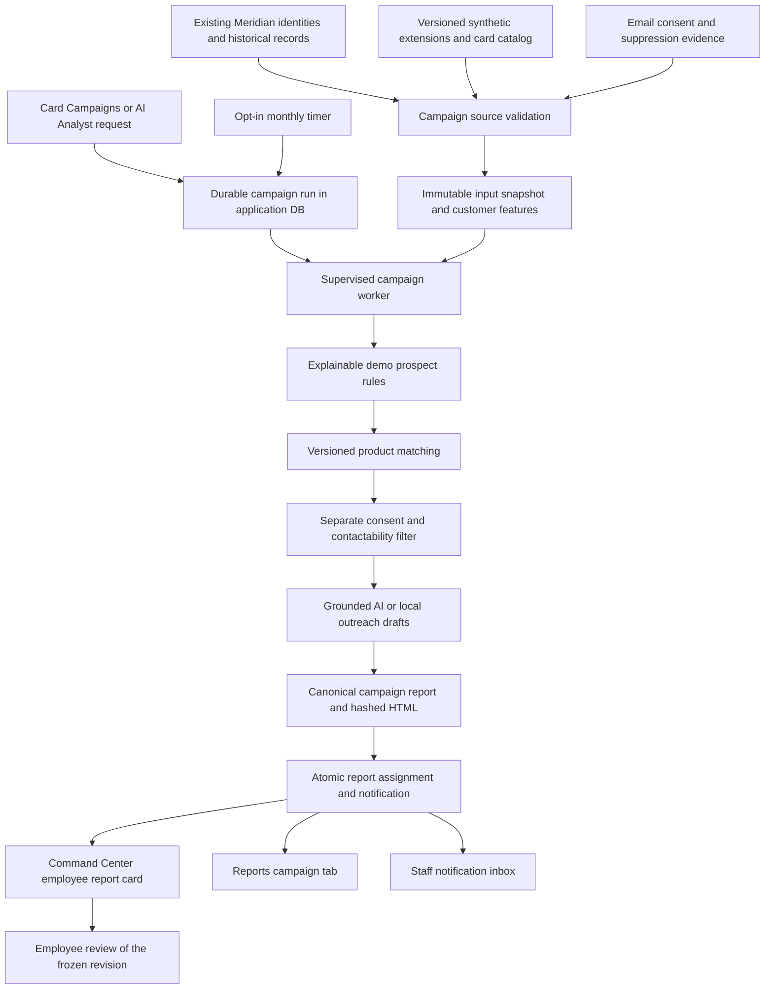

# Card Campaigns: data, pipeline, and employee reporting plan

Prepared 14 October 2026. **First release implemented; original design decisions retained below.**

This plan translates the attached Credit Card Recommendation & Outreach Automation proposal into the current BankWeaveAI architecture. The first release replaces the **Scenario Simulator** workspace page with **Card Campaigns** and ends with an employee receiving a campaign report in Command Center, Reports, and the notification inbox. Customer emails are prepared as drafts; customer delivery, card issuance, applications, and reply tracking are later work.

Use this document with [current architecture](architecture.md), [data sources](data-sources.md), [imports](imports.md), and [deployment roadmap](roadmap.md). Sections describing existing behavior are observations from source and read-only database inspection. The original proposal wording below records the design reference. The first release is implemented in `backend/features/campaigns/`, `frontend/src/features/campaigns/`, and migrations 018–020; current behavior and operational commands are in [architecture](architecture.md#card-campaigns-and-employee-reports) and [deployment](deployment.md#card-campaign-worker).

## 1. Decisions for the first release

| Question                                  | Proposed decision                                                                                                                                                                                                          |
| ----------------------------------------- | -------------------------------------------------------------------------------------------------------------------------------------------------------------------------------------------------------------------------- |
| Where does the feature live?              | Replace Scenario Simulator with Card Campaigns in the same sidebar position. Command Center remains the home page.                                                                                                         |
| What is the finished workflow?            | Select a campaign month → validate inputs → build customer features → apply demo prospect rules → match products → prepare outreach drafts → generate an immutable report → deliver it to assigned staff in the dashboard. |
| What does “send report to employee” mean? | Publish an assigned report and an unread in-app notification. It does not mean emailing the employee or sending promotions to customers.                                                                                   |
| Which customers?                          | A reproducible pilot cohort of 5,000 existing Meridian customers, expandable to the original 10,000. Create no duplicate customer identities.                                                                              |
| Which dataset?                            | Meridian/INR only initially. BankShield remains available for its existing historical analyses; its incomplete joins and missing lending observations exclude it from campaigns.                                           |
| What history?                             | October 2025–September 2026 for an October 2026 campaign. Use the last completed month as the cutoff; do not manufacture October outcomes or use future events.                                                            |
| More database files?                      | Keep one application database and the existing checkpoint database. Add feature tables and a clear data catalog inside the application database.                                                                           |
| AI's responsibility?                      | Understand bounded campaign requests and draft grounded explanations. Database tools calculate metrics; versioned rules decide demo prospect status and product fit.                                                       |
| Automation?                               | The same durable pipeline supports an employee-triggered run and an opt-in monthly schedule. A schedule never creates customer delivery actions.                                                                           |
| Employee decisions?                       | Admin can record Reviewed, Request changes, or Reject against the exact report revision. Reviewed means reviewed for the demo; it does not authorize customer sending or a credit approval.                                |
| New infrastructure?                       | Use the current VM, FastAPI, Next.js, SQLite, and Vertex/local provider. Add a supervised campaign worker and optional monthly timer; postpone a database/platform migration.                                              |

These defaults define the implemented first release. Future changes must retain source/version boundaries and explicit staff permissions.

## 2. What already exists and what is missing

### Current storage and data

The active storage directory is `/home/harshilsangani07/bankweave-state/storage`. It contains `risklens.sqlite3` for application data and `agent-checkpoints.sqlite3` for LangGraph state. Source fixtures/caches and QA backups are not additional production application databases. A read-only inspection found **49 application tables and two registered datasets**.

| Existing area                  | Verified state                                                                                       | Use in the new feature                                                                                 |
| ------------------------------ | ---------------------------------------------------------------------------------------------------- | ------------------------------------------------------------------------------------------------------ |
| Meridian identity/account data | 10,000 linked customers/profiles/accounts; original IDs retained                                     | Canonical customer/account references and staff display details                                        |
| Meridian transactions          | 120,000 transactions, April–September 2026, INR                                                      | Recorded synthetic spending categories, channels, and date windows                                     |
| BankShield sample              | 2,500 customers, 5,000 transactions, historical USD, incomplete links                                | Keep separate; campaign runs return an unsupported-dataset explanation                                 |
| `customer_master`              | Synthetic credit score and demographic fields                                                        | Source for explicitly labeled demo score snapshots; demographic attributes are not product-fit proxies |
| Cashflow observations          | 180,000 events: generated payroll plus synthetic outgoing classifications                            | Reuse labeled observations; they are not verified income or debit/credit direction                     |
| Repayment observations         | 48,000 installments; 47,235 principal payment records                                                | Dated principal delinquency evidence; not complete EMI, interest, or external debt                     |
| Declared needs                 | `customer_preferences.consent` supports needs/insurance/support suggestions                          | Keep its existing meaning; it is not email-marketing consent                                           |
| Recommendations                | Per-customer declared-needs rules and review events                                                  | Reuse design patterns, not the same recommendation payload or consent field                            |
| Reports                        | Canonical investigation artifacts and hashed HTML downloads                                          | Reuse immutable storage/rendering conventions; introduce a separate campaign report type               |
| Roles                          | Viewer, Analyst, Admin; current demo identities; prepared IAP adapter                                | Extend explicit feature permissions and ownership checks                                               |
| Execution                      | Request-bound SSE operations, replay IDs, in-memory cancellation, roughly 110-second stream lifetime | Reuse progress conventions; add a durable worker for batch campaigns                                   |

The inspection confirms that “more data” means missing fields and dated evidence rather than more database servers. Needed additions are: dated campaign credit/obligation profiles; existing card holdings; explicit email-marketing consent and suppression; versioned card benefits/fees/rules; reproducible input batches; and campaign execution/report/assignment records.

### Current code to preserve or extend

| Existing reference                                                                                                 | Proposed relationship                                                                                                                      |
| ------------------------------------------------------------------------------------------------------------------ | ------------------------------------------------------------------------------------------------------------------------------------------ |
| `backend/core/database.py`, `backend/migrations/`                                                                  | Keep SQLite access and append-only migrations; do not edit applied migrations                                                              |
| `backend/features/products/cashflow.py`, `backend/features/products/repayments.py`                                 | Reuse source reconciliation and calculation conventions; add batch SQL helpers rather than calling per-customer HTTP endpoints 5,000 times |
| `backend/features/products/recommendations.py`                                                                     | Reuse input hashes, versioned rules, evidence, and optimistic review revisions                                                             |
| `backend/features/forms/approvals.py`                                                                              | Reuse locked snapshots/atomic audit patterns; keep OCR customer approvals separate                                                         |
| `backend/integrations/ai/__init__.py`, `backend/workflows/analyst.py`                                              | Add typed campaign routing/drafting capabilities without giving Gemini SQL or approval tools                                               |
| `backend/workflows/operations.py`, `backend/core/progress.py`                                                      | Reuse request validation/progress labels; durable campaign jobs survive HTTP disconnects and restarts                                      |
| `backend/features/reports/html.py`, `backend/features/workspaces/sessions.py`                                      | Keep legacy report ownership; add assigned campaign-report access rather than borrowing another employee's session                         |
| `backend/core/security.py`, `frontend/src/shared/api/server.ts`, section `api.ts` modules                          | Preserve the same-origin gateway and server-side permissions; browser roles/IDs never grant authority                                      |
| `frontend/src/features/dashboard/components/dashboard.tsx`, `frontend/src/features/reports/components/reports.tsx` | Show assigned campaign reports while preserving existing risk metrics and investigation reports                                            |

## 3. Proposed architecture

The application database is the source of truth for runs, evidence, drafts, review decisions, and delivery to employees. LangGraph supports conversational routing and explanation; a checkpoint is not the authoritative campaign decision or report receipt.

## 4. Organize data before adding automation

### One data catalog and explicit domains

Group the existing tables logically into identity/accounts, transaction/risk, lending/repayments, customer products/preferences, reviewed operations, conversations/artifacts, and the new campaigns domain. This is a repository/data-catalog organization, not a destructive schema rewrite.

Extend the existing dataset metadata with campaign capability and source-coverage information. Each campaign input batch records cohort membership, source files/versions, row counts, date bounds, currency, generator seed/version, schema version, checksums, and validation findings. Make a read-only **Campaign data readiness** panel in Data Workspace; it should show what is available and what is missing without exposing a raw database browser.

All new records follow these conventions:

- Include tenant, dataset, stable customer/account references, source batch/version, and effective date where applicable. Enforce composite parent references to prevent cross-dataset joins.
- Store money in integer minor units and an explicit currency. Do not mix BankShield USD with Meridian INR.
- Keep timestamps in UTC and business dates separately; campaign calendar boundaries and displayed schedules use `Asia/Kolkata`.
- Record both observation/effective time and availability time for dated evidence. A late-arriving observation cannot leak into an earlier completed campaign.
- Distinguish synthetic, imported, and derived provenance. Unknown evidence remains unknown; missing credit scores, debt, consent, or holdings cannot silently become zero or “good.”
- Apply schema/range/uniqueness/parent/date checks before publishing a batch. Missing optional customer evidence quarantines that customer; invalid currency, systemic broken links, or an unusable batch fails the run.
- Use indexed, paginated queries. Keep source facts normalized, and reserve JSON for immutable evidence/manifests and typed report snapshots.

Keep existing migration checksums and legacy `RISKLENS_*`, `x-risklens-*`, actor, session, and storage identifiers intact. No startup or scheduled job reseeds the working store.

### Reproducible synthetic data

Generate the campaign extension with a fixed seed and explicit batch ID in an isolated workspace first. Select 5,000 existing Meridian customer IDs with a deterministic, branch-balanced cohort algorithm. Store the membership in the manifest so a rerun never silently changes the analyzed population. Keep customer names/emails in existing profile storage; fictional addresses remain under `.example.test` domains.

Use the existing April–September observations for those six months. Generate the preceding six months, October 2025–March 2026, as campaign-only extension observations. Do not insert them into the original transaction/cashflow tables or enlarge the historical fraud dataset's reporting periods. The report distinguishes the reused six-month source from the six-month synthetic extension. Later, a campaign-only cohort can expand to all 10,000 customers without generating another customer master.

Add dated synthetic score snapshots, declared obligation details, existing card holdings, and email consent events. Income/balance/debt values must reconcile with their stated source. In the existing six months, use recorded generated payroll rather than replacing it with an unrelated salary; derive a daily-balance proxy by replaying the opening balance, cashflow, and principal payments. Label it a synthetic ledger balance, not an observed bank balance.

Generate missing obligation components separately with explicit provenance: monthly interest/fees and outside obligations are not inferred from the principal-only ledger. Their sum can support a **demo debt-burden ratio** only when the necessary fields are complete; otherwise return insufficient data. Do not count a loan principal payment twice. Source credit scores copied into a dated fixture remain generated demo scores, not bureau checks.

Use recorded Travel, Retail, Electronics, and Groceries categories. Retail/Electronics with an Online channel may support a shopping-spend demo category; a Travel label does not prove flight purchases, hotels, or lounge usage. Generated extensions may have more detailed categories, with their synthetic origin visible.

Include ordinary records and known edge cases: missing score, thin history, insufficient income history, high obligations, overdue principal, missing obligation components, existing matching card, absent consent, withdrawn consent, suppressed contact, invalid email, incomplete parent link, no product match, and exact rule boundaries. Missing or unsafe evidence must not be invented to satisfy a target campaign size.

The generator emits a manifest and validation report. An explicit import command loads only the new domain in dependency order, verifies hashes/IDs, and is idempotent for a batch. Published batches are immutable; corrections create a new version. Its manifest freezes the relevant existing source observations for replay rather than relying on whatever the mutable source tables contain later. Generating/loading these files is implementation work and is not authorized by this planning step.

### Proposed tables and migration boundaries

These are logical table names to finalize against the schema at implementation time. Add them to the application DB, with indexes/foreign keys, rather than creating a database file for each domain.

| Table                            | Purpose and important keys                                                                                                                                                                      |
| -------------------------------- | ----------------------------------------------------------------------------------------------------------------------------------------------------------------------------------------------- |
| `campaign_input_batches`         | Immutable source/cohort manifest; tenant, dataset, batch ID, generator/version, checksums, period coverage, validation status                                                                   |
| `campaign_spending_observations` | Campaign-only historical extension; batch/customer/account/event identity, business date, direction/category/channel, amount/currency, provenance; original facts stay in their existing tables |
| `campaign_credit_profiles`       | Dated score and obligation observations; income/debt completeness, collateral evidence where needed, effective/available dates, source references                                               |
| `card_product_versions`          | Fictional travel, shopping cashback, and entry-level/secured product versions; approved benefit IDs, fees/conditions, effective dates, rule configuration and review status                     |
| `customer_card_holdings`         | Dated known card ownership; missing coverage is unknown, not automatically “no cards”                                                                                                           |
| `marketing_consent_events`       | Channel/purpose-specific grant, withdrawal, or suppression; evidence/source, recorded/effective dates, optional contact-frequency history; unrelated declared-needs consent is untouched        |
| `campaign_features`              | Immutable per-batch/customer/cutoff feature snapshot with source hashes and quality flags                                                                                                       |
| `card_campaigns`                 | Campaign definition/revision, product scope, month/window, owner, assigned reviewers, timezone, optional monthly schedule configuration                                                         |
| `campaign_runs`                  | Durable job, frozen input versions, idempotency key, stage checkpoints, lease/heartbeat, retry/cancellation status, model budget, final report ID                                               |
| `campaign_candidates`            | One customer row per run with readiness status, selected product/alternatives, fit reasons, rule/consent evidence, and suppression reason                                                       |
| `campaign_drafts`                | Candidate-linked subject/body/template versions, grounded benefit references, provider/model metadata, validation result and content hash                                                       |
| `campaign_reports`               | Run-linked canonical artifact and HTML reference, report revision/hash, tenant, staff assignment and publication status                                                                         |
| `campaign_review_events`         | Append-only employee decisions bound to report/run hash and revision; actor, note, time                                                                                                         |
| `staff_notifications`            | Actor-assigned in-app notification and read status; unique recipient/report/type key for deduplication                                                                                          |

Reuse `artifacts`/`report_files` storage where appropriate, with a distinct campaign report kind and explicit access mapping. Do not overload existing OCR approval requests or rewrite investigation report payloads.

Proposed migration grouping: `018_campaign_data` for source/catalog/consent tables; `019_campaign_execution` for features/campaigns/runs/candidates/drafts; `020_campaign_reporting` for reports/reviews/notifications. These numbers are provisional: use the next unused migration numbers after rechecking the repository and working store. Do not create SQL migration files during planning.

## 5. Prospect rules and product matching

Keep **data readiness**, **demo prospect screening**, **product fit**, and **contact permission** as separate results. A favorable product match cannot override missing credit evidence or withdrawn consent.

1. Validate the customer's source coverage as of the cutoff. Use only evidence effective and available by that cutoff. Require explicit holdings coverage, income window, score coverage appropriate to the product, and obligation completeness.
2. Apply versioned, fictional product screening rules: configured adult-age requirement, minimum complete income history, demo score/income boundaries, demo obligation ratio, and dated delinquency policy. Do not present the static legacy default markers as a bureau outcome.
3. Evaluate product fit from spending categories and stated preferences. Travel, shopping cashback, and entry-level products have transparent formula weights and deterministic tie-breaking. Prefer a useful match with appropriate fees; do not optimize on protected demographic proxies or claim savings without a stated calculation.
4. Suppress already-held identical products using dated holdings. Unknown holdings is a review issue. A secured-card suggestion requires recorded synthetic deposit/collateral evidence; it is not a default escape from missing credit data.
5. Apply email-marketing consent, suppression, address validity, and configured contact limits separately. Recheck current withdrawals before preparing/finalizing a contactable draft list. Snapshot historical consent and current suppression checks independently.

Candidate outcomes are **Potential prospect — staff review required**, **No matching demo offer**, or **Insufficient data**. Contact status is separately **Draft allowed** or **Suppressed**, with reason codes. These are not card approvals, credit limits, lending decisions, or claims that a customer is pre-approved.

The initial fictional catalog must visibly tag its thresholds as demo configuration. Bank-approved production rules are a later input; the attached proposal does not establish appropriate score/income/debt thresholds. Store each ruleset version and test every configured boundary. Never let Gemini select or modify those thresholds.

## 6. Durable pipeline and automation

| Stage                    | Stored output                                                       | Failure/retry behavior                                                                                      |
| ------------------------ | ------------------------------------------------------------------- | ----------------------------------------------------------------------------------------------------------- |
| Accept run               | Campaign revision, owner/recipients, bounded scope, durable run key | Same request ID and same input returns the existing run; changed input with that ID returns conflict        |
| Validate sources         | Readiness report, source/cohort manifest                            | Systemic invalid data fails before drafting; individual incomplete customers receive reason codes           |
| Freeze/build features    | Source snapshot hashes, per-customer feature rows                   | Resume completed batches; exclude future or unavailable-at-cutoff facts                                     |
| Screen and match         | Candidate statuses, products, evidence                              | Fully deterministic and replayable from frozen inputs                                                       |
| Check contact permission | Consent/suppression snapshots and permitted draft list              | Unknown/revoked consent suppresses drafting; no contactable candidates is a valid completed result          |
| Prepare drafts           | Versioned content with validation/provider metadata                 | Invalid content is rejected; bounded retries and labeled local/template fallback are available              |
| Build report             | Reconciled counters, canonical payload, hashed HTML                 | Do not publish an incomplete or mismatched report as successful                                             |
| Deliver to staff         | Assignment, report pointer, unread notification                     | Publication and deduplicated notifications commit atomically; retry never creates another employee delivery |

Use a dedicated worker with jobs/leases in SQLite and short transactions. The manual endpoint returns a run ID promptly; the UI polls stored progress. Closing the browser or losing an SSE connection does not cancel an accepted campaign. An explicit cancellation stops at a safe stage boundary and never publishes a partial report as ready.

Existing request-bound SSE operations are not sufficient for a 5,000-customer monthly workload: their running cancellation state is in memory and their stream lifetime is bounded. Keep them for existing chat/form tasks. Campaign worker restart recovery reads durable stage checkpoints and reclaims expired leases; it does not depend on a still-open chat.

Use one worker initially. Claim jobs atomically; never keep a SQLite transaction open during a Vertex call. Process bounded customer batches with parameterized bulk SQL. Cache drafts by frozen facts, catalog/template version, language, and provider configuration. Separate the frozen run specification from execution attempts, so retries use the same inputs and new source data requires an explicit campaign revision.

Run states are `queued → validating → building_features → matching → drafting → reporting → ready`, with explicit `failed` and `cancelled` terminal outcomes. A resumed execution continues the same frozen run; an explicitly revised campaign gets a new run. Provider fallback can produce `ready` with a recorded warning, but incomplete candidate counts or failed report publication cannot. Track employee review separately as `pending_review`, `reviewed`, `changes_requested`, or `rejected`; review status does not change an immutable run result or create a sending state.

For scheduled execution, deduplicate on tenant + campaign definition/revision + campaign month. Set the initial example schedule to **09:00 IST on the first day of the month**, using the prior month's completed cutoff; enabling a schedule is an explicit admin action. An October 2026 manual demo can run now against the September cutoff. If new data is unavailable in November, show a stale-source/insufficient-coverage result instead of inventing new activity or silently treating September as October.

Use an explicit, restricted campaign-worker principal with only campaign-run capabilities and configured recipients. Do not impersonate an Admin, inherit the fallback demo actor, or attach a scheduler to an employee's private chat recovery key. Local scheduling uses a supervised worker plus a timer that enqueues a run through the same repository/domain service. Cloud scheduling is a later adapter after the existing cloud identity/storage work. Design for repeated triggers: Cloud Scheduler documents at-least-once delivery, so the enqueue/publish operations must be idempotent. [Google Cloud Scheduler overview](https://docs.cloud.google.com/scheduler/docs/overview?hl=en).

## 7. Gemini drafting, grounding, and cost controls

Gemini receives approved product content plus a small anonymous explanation context: category/spend bands, selected benefit IDs, and safe reason codes. It receives no customer email/address, full statement, database credential, SQL interface, exact bureau data, or campaign approval tool. Insert the display name/contact details locally when staff views or exports a draft. Record actual outbound fields and provider/model/template versions, extending the current provider metadata pattern.

Add a typed draft result such as subject, body, benefit references, and required-disclosure references. Numerical benefits, annual fees, waivers, conditions, eligibility caveats, and application instructions come from the selected frozen catalog version through validated placeholders. Reject unknown benefit references, invented fees, guaranteed/pre-approved claims, unsupported savings, and instructions that attempt to select tools. Render plain text or escaped Markdown/HTML.

Do not make 5,000 uncontrolled model requests. Default to product/segment templates plus deterministic fact-based personalization for all permitted candidates. Start with at most three segment-template requests and twenty optional sample-specific rewrites per run; make the limit explicit in run configuration. Additional AI personalization is opt-in and subject to a run token/call budget and bounded concurrency. The complete report covers the full cohort even when only sample drafts receive individual model rewrites.

The local provider creates the same report/draft contract with labeled templates. If Vertex is unavailable, record the fallback and warning rather than presenting templates as AI-generated. No candidate gets invented eligibility or benefits to compensate for a provider failure.

## 8. Employee report, dashboard, and review

### Report contents

Each report includes campaign/run ID and revision; owner and assigned staff; campaign month and source cutoff; cohort/source coverage; rule/catalog/template versions; source and report hashes; and actual pipeline/provider statuses. Show these counts calculated from the canonical candidate/draft rows:

- Customers selected, successfully analyzed, and quarantined for insufficient data.
- Potential prospects and no-match customers, with exclusion-reason totals.
- Marketing-consented/contactable prospects and suppressed prospects, by reason.
- Recommended product distribution, selected primary match, and alternatives.
- Drafts prepared/validated, samples rewritten by Gemini, and template/fallback counts.
- **Customer emails sent: 0** in this release; the report does not fabricate outreach metrics.

Counters must reconcile: cohort = analyzed + quarantined; analyzed = potential prospects + no match; potential prospects = draft-allowed + suppressed. Give each customer one primary status/reason for additive totals and retain secondary reason flags separately. A customer with multiple product matches is counted once in the headline prospect count.

The detail view has a paginated prospect list with customer reference, card, explainable reasons, data-quality flags, contact permission, draft status, and source links. Show sensitive financial/contact detail only to authorized staff; a dashboard summary does not need full emails or exact scores. Include exclusion examples and required follow-up, not just successful matches. HTML downloads are server-rendered from stored canonical facts; repeat downloads retain the same content hash. Any later export of rows should protect against spreadsheet formula injection.

### In-app delivery

Add a **Campaign reports for you** card to Command Center with month, status, prospect/contactable/draft counts, delivery time, and Open report. Preserve its existing fraud/loan metrics and risk cards. Add an unread campaign item to the existing notification dialog and a **Card campaigns** tab alongside investigation reports in Reports.

Publication means the report and its recipient assignments are committed and visible through an authorized query, with exactly one notification per recipient/report. Marking a notification read does not approve the report. If a scheduled campaign has no valid staff recipient, fail configuration validation before accepting it. Record recipient actor IDs, not just browser session IDs or role labels.

For a manual run, default the requesting Analyst/Admin as the report owner and include a configured same-tenant Admin reviewer. Scheduled runs use explicitly configured recipients. The development adapter can demonstrate assignments with its stable demo actors; real named-employee delivery requires the existing verified-identity work. A schedule never broadcasts customer details to every staff member.

Add explicit permissions: Viewer sees an assigned permitted summary; Analyst creates/runs and reads their authorized reports/drafts; Admin manages catalog/schedules and reviews same-tenant reports. Recipient assignment alone does not grant sensitive-detail or Admin permissions. Enforce these checks at every list/detail/download/review endpoint, including GET endpoints; existing generic read permission is not enough.

Admin review decisions are bound to the exact report hash and revision. Request changes produces a new campaign revision/run, leaving the old report intact; Reject archives the reviewed revision; Reviewed records the decision and note. None of these creates a customer email send, account, or card. A future real outreach release will need a separate approval and delivery state machine.

## 9. Frontend and API changes to plan

### Card Campaigns page

Use a task-oriented page with campaign month, dataset/cohort readiness, product scope, recipients, a Prepare employee report action, and visible progress. Tabs show Overview, Prospects, Email drafts, Employee report, and Run history. New Chat remains exclusively in AI Analyst; it is not added to this page.

Data Workspace gains a read-only campaign readiness/coverage view; Admin configuration covers fictional product/rules versions and optional schedules. Add a searchable Card Campaigns guide to Knowledge Library and update affected investigation/report guides.

### Proposed backend contracts

| Endpoint                                                                                                                         | Behavior                                                                                     |
| -------------------------------------------------------------------------------------------------------------------------------- | -------------------------------------------------------------------------------------------- |
| `GET /card-campaigns/readiness`                                                                                                  | Dataset/cutoff/cohort coverage and missing-input summary                                     |
| `GET /card-campaigns/products`                                                                                                   | Active authorized catalog versions and demo rule labels                                      |
| `POST /card-campaigns`                                                                                                           | Create a validated definition and staff assignment; no run/delivery side effect              |
| `GET /card-campaigns` and `GET /card-campaigns/{id}`                                                                             | Authorized campaign list/detail                                                              |
| `POST /card-campaigns/{id}/runs`                                                                                                 | Explicit bounded run acceptance with idempotency key; return run ID                          |
| `GET /card-campaigns/{id}/runs/{runId}`                                                                                          | Stored progress, counts, errors, and immutable result pointer                                |
| `POST /card-campaigns/{id}/runs/{runId}/cancel`                                                                                  | Explicit cancellation request at safe boundaries                                             |
| `GET /card-campaigns/{id}/runs/{runId}/candidates`                                                                               | Paginated authorized prospect/evidence/draft detail                                          |
| `GET /campaign-reports` and `GET /campaign-reports/{id}`                                                                         | Assigned/authorized report list/detail                                                       |
| `GET /campaign-reports/{id}/download`                                                                                            | Hashed canonical HTML with campaign-specific ownership checks                                |
| `POST /campaign-reports/{id}/review`                                                                                             | Revision/hash-bound staff decision and atomic review event                                   |
| `GET /staff-notifications`, `PATCH /staff-notifications/{id}`, `DELETE /staff-notifications`, `DELETE /staff-notifications/{id}` | Authorized notification list, read status, and removal of the signed-in recipient's own rows |

Add admin catalog/schedule configuration endpoints when their UI is implemented; reject unknown fields and inconsistent revisions. Same-origin Next gateways mirror these routes and preserve backend status/error handling. Do not expose a generic browser SQL endpoint or public scheduler trigger.

Campaign/report/inbox endpoints authorize against tenant, actor, and assignment rather than a selected chat. Adapt the middleware boundary for these endpoints so a campaign request does not create or bind a private conversation just because the shared client carries a recovery header. Reject foreign ownership directly, and keep the existing session/conversation binding behavior for legacy chat/form routes. All new GET endpoints remain observational apart from explicit access auditing; creating a run, generating new results, marking an inbox item read, and reviewing a report use explicit mutations.

Use distinct `CampaignContext`, candidate, run, report, and draft types. Campaign month/source window must not be confused with the Analyst's six-month fraud reporting period. Keep the existing `WorkspaceSession.reports` investigation contract; load campaign reports separately and combine them through a discriminated frontend view. Do not pass campaign reports into renderers that require `report.investigation`.

### AI Analyst integration

Add a typed campaign intent/node after the data/rules/pipeline APIs work. For “Prepare October cashback prospects and an employee report,” resolve a supported cohort/product/month, create a previewable specification, and require an explicit run action when defaults/recipients are not established. The page's configured Prepare action is explicit authorization for a run. Model text is never authorization for a review decision, schedule change, or external send.

Chat returns a run link and stored progress, then a report summary/link when complete; it need not hold a 5,000-customer operation open in the existing SSE worker. Add a campaign action/result block with an actual campaign/run/report ID rather than reusing risk IDs. Requests to send customer emails explain the available draft/report workflow. BankShield requests show the unsupported-data reason. Version and test the new graph path so existing saved extraction checkpoints and chat replies remain usable.

## 10. Remove Scenario Simulator without breaking saved work

The removal affects more than a sidebar label. Inspect and update:

- `frontend/src/features/workspace/components/shell.tsx`, `frontend/src/shared/types/scope.ts`, `frontend/src/app/page.tsx`: navigation, page types, and rendered page.
- `frontend/src/features/workspace/hooks/use-workspace.ts`, `frontend/src/features/investigations/components/investigation.tsx`: new scenario state/actions and investigation CTA.
- `frontend/src/shared/analytics/blocks.tsx`, `frontend/src/features/analyst/components/analyst.tsx`, and provider/analytics responses: generated simulate actions and legacy action rendering.
- section-owned types, section `api.ts` modules, relevant API contracts, browser tests, and `frontend/src/features/workspace/hooks/use-webmcp.ts`: navigation/action schemas and integrations.
- The retired simulator screen and its unused controls are removed; legacy comparison rendering is retained in the Reports feature. Knowledge Library guides and navigation point to Card Campaigns.

New investigations create ordinary reports without the simulator CTA. The old `#scenario-simulator` URL opens Card Campaigns with a brief moved-page notice; it does not reinterpret a saved fraud scenario as a campaign.

Keep legacy scenario payload/types and immutable report rendering for existing saved artifacts. Old chat simulation buttons show an unavailable/retired action instead of silently starting marketing work. Retain the bounded legacy `/scenarios` contract for a documented compatibility window if existing clients still use it, while removing it from the visible product; final API removal is a separate versioned decision. Do not delete history, rewrite prior report HTML, or remove applied data migrations.

## 11. Implementation order and completion criteria

| Phase                                    | Work                                                                                                                    | Required evidence before proceeding                                                                                                                               |
| ---------------------------------------- | ----------------------------------------------------------------------------------------------------------------------- | ----------------------------------------------------------------------------------------------------------------------------------------------------------------- |
| 1. Data foundations                      | Catalog/coverage inventory, additive schema, generator/manifest, source validation, isolated import, data readiness API | Fixed-seed reruns match; 5,000 customers link to existing IDs; no original fixtures/records/metrics are changed; incomplete/invalid batches are handled correctly |
| 2. Product rules                         | Versioned fictional catalog, dated features, prospect/fit/contact rules and reason codes                                | Exact boundary tests, unknown-data behavior, dated no-lookahead joins, debt reconciliation, consent withdrawal, held-card suppression, and reconciled counts pass |
| 3. Durable execution                     | Run repository, idempotency/leases/checkpoints, manual API and worker                                                   | Double-submit, conflicting IDs, browser disconnect, process crash/restart, cancellation, expired lease, and concurrent claim tests pass                           |
| 4. Drafts and employee reports           | Typed Vertex/local drafting, budgets, canonical HTML, staff assignment, notifications, review events                    | Benefits/fees are grounded; fallback is labeled; report hashes are stable; retries publish once; unauthorized list/detail/download/review access is denied        |
| 5. Product replacement                   | Card Campaigns page, Command Center/report/inbox integration, readiness view, Knowledge guides, Scenario retirement     | Desktop/mobile and light/dark flows pass; legacy reports/chats/checkpoints still open; no remaining new-flow simulator buttons                                    |
| 6. Conversational and monthly automation | Typed Analyst intent, report/run links, restricted worker identity, opt-in timer, stale-source handling                 | Same result for page/chat/scheduled input; retries do not duplicate runs/reports; no invented new-month data; no automatic customer contact                       |

The first implementation should start with Phase 1. Do not begin by changing the Scenario Simulator label and filling a new page with placeholder counts. Keep it available until the new page can complete the report workflow, then switch navigation as part of the tested frontend release.

End-to-end acceptance: a staff member selects October 2026, sees the September cutoff and 12-month labeled history, runs the 5,000-customer cohort, sees calculated prospects and suppression reasons, reviews valid email drafts, and receives a report in Command Center/Reports with an unread notification. The report shows zero customer emails sent. Re-running the same accepted request returns the same result; an explicit revised run creates a new immutable report.

Run migration, generator, rule, worker/recovery, permission, API, and affected browser tests against disposable storage. Include customer-link integrity, unchanged old KPI/report hashes, and original saved-work recovery checks. Test worker performance on the actual 5,000-customer cohort and record runtime, query count, peak memory, model calls/tokens, and publication latency; set deployment limits from those measurements rather than claiming an untested SLA.

Before a future production promotion, retain a matched application/checkpoint backup and the previous frontend build; use migrations deliberately, then restart only the changed services. The implementation rollout backs up matched application/checkpoint state, applies additive migrations deliberately, and rebuilds/restarts the existing port 3000 frontend and Vertex backend.

## 12. Later customer outreach and production prerequisites

Real customer delivery needs its own approved scope: verified staff identity, bank-approved products and screening rules, channel-specific consent/opt-out handling, contact-frequency enforcement, approved templates/terms, private storage/retention, an email provider, durable outbox/idempotency, delivery webhooks, and customer reply/follow-up handling. Do not connect an email provider or enable sending as part of the report-only release. A mock delivery event must be labeled simulated, not sent.

The pasted 2022 regulatory reference should not be used as the current production policy. RBI's official commercial-bank card directions page now identifies the 2025 directions updated 1 October 2026. The historical RBI FAQ discusses separate issuance consent. Marketing permission, employee review, and customer card issuance consent remain separate concepts; the feature does not perform issuance. [Current RBI directions](https://www.rbi.org.in/Scripts/BS_ViewMasDirections.aspx?id=13155), [historical RBI FAQ](https://www.rbi.org.in/commonman/Upload/English/FAQs/PDFs/FAQMDCreditCardandDebitCard.pdf). Map applicable rules for the actual bank/channel before a real outreach release; do not assume SMS/telecom requirements automatically describe email or label the demo compliant.

Existing roadmap items for managed persistence (G04), verified identity (G05), retained storage (G06), quotas (G07), scheduling (G08), and processing/retention (G09) still apply. Adding this demo does not complete those production tasks. SQLite remains appropriate for the initial bounded VM workflow; reconsider a managed database when measured worker concurrency, retention, availability, or production hosting requires it.

## 13. Implementation status

The owner subsequently authorized implementation after checking Research mode. The first release includes the explicit synthetic generator, immutable source/catalog versions, deterministic rules, durable worker, grounded drafts, actor-assigned reports and notifications, Card Campaigns replacement, data-readiness panel, Analyst routing and opt-in monthly scheduling. Admin review does not authorize sending. Customer delivery and the production prerequisites in section 12 remain future work.

Default development assignment includes the requesting staff actor and local Admin. Verified named employee assignment configuration is a later production identity task; the UI does not claim to send email to employees. Campaign employee reports download as HTML; Analyst research briefs download as PDF with charts. Both use stored canonical facts.
